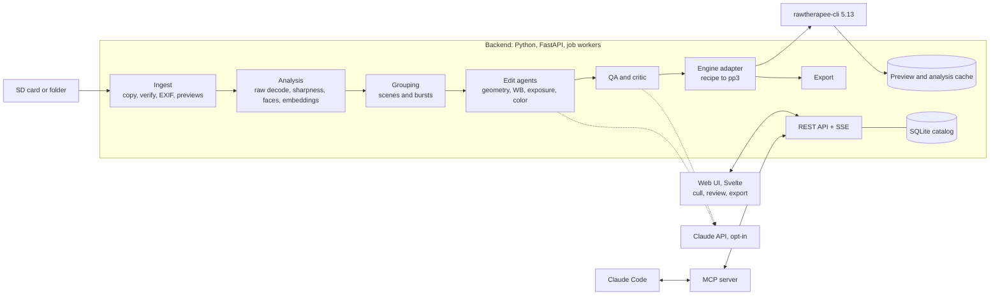
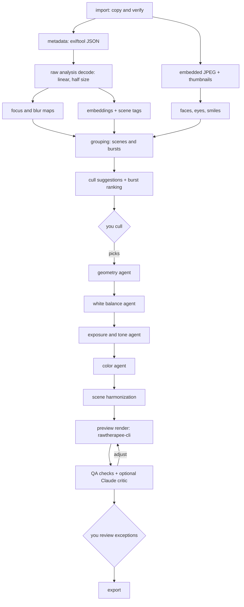

# RAW Image Editor — Implementation Plan

**Draft v0.1 · for review · 2026-11-16**

Camera: Nikon D7100 (NEF). Target machine: Omarchy (Arch Linux) · Ryzen 7 3700X (8C/16T) · 32 GB RAM · GeForce GTX 1650 (4 GB). Already installed: RawTherapee 5.13, exiftool 13.55, LibRaw 0.22, libvips 8.18, lensfun 0.3.4.

> **How to review:** read §0, then the proposed decisions in §3.2 and the open questions in §12. The rest is detail that follows from those.

---

## 0. TL;DR

- **The workflow:** card → import → AI pre-cull → **you pick** → agents edit → **you skim only the exceptions** → export.
- **You choose the moment; the machine does the technical work.** The UI is a keyboard-driven culling and review tool, not a slider-heavy editor.
- **Don't build a RAW engine.** RawTherapee 5.13 (already installed) does all rendering. The app drives it with generated `.pp3` profiles, which are plain text, documented, and stackable (`rawtherapee-cli -p base.pp3 -p image.pp3`). The app owns the *decisions* (analysis and agents) and RawTherapee owns the *pixels*. You can open any photo in the RawTherapee GUI, with the app's edits applied, to finish it by hand.
- **Edits are parametric recipes, never baked pixels.** Every parameter records who set it (an agent or you), how confident it was, and why. Anything you change is locked, and agents never overwrite it.
- **Confidence routing:** if an agent is sure, the change is applied silently. If it's unsure, the change is applied conservatively and the photo goes into a short review queue. If it has no idea, the photo stays as shot and is flagged.
- **Classical computer vision and small local models handle measurement** (focus, white balance, exposure, horizon). **Claude handles judgment**: scene intent ("keep this sunset warm", "this tilt is deliberate") and a critic pass on uncertain or hero shots. An **MCP server** lets you drive the library from Claude Code in plain language.
- **Stack:** Python + uv (same conventions as your other side projects), FastAPI, SQLite, and a Svelte UI on localhost.
- **Roadmap:** Phase 1 makes culling faster (focus and eye checks, burst compare). Phase 2 makes picks come out already edited. Phase 3 adds Claude and MCP. Phase 4 learns your taste.

---

## 1. Goals, non-goals, principles

### Goals
1. **Automate the technical edits:** white balance, exposure and tone, color, straightening and crop, lens corrections, noise reduction, and focus/blur detection.
2. **Make the human decisions fast:** the best moment, the right smile, which frame of a burst. The AI suggests; you decide.
3. **Keep RAW quality and non-destructive editing:** originals are never modified, and every edit is reproducible and reversible.
4. **Learn your taste** from your overrides and picks.
5. **Be scriptable and agent-drivable:** CLI, local API, MCP.

### Non-goals for v1
- A full manual editor (curves, masks, hundreds of sliders). The RawTherapee GUI is the escape hatch.
- Retouching, compositing (face or head swaps), generative fill.
- Local adjustments and masks (a v2 candidate).
- Asset management beyond shoots (keywords, people albums, face *recognition*), cloud sync, mobile, multiple users.
- Other cameras. The design stays camera-agnostic, but tuning and tests target the D7100.

### Principles
1. **You pick, the machine fixes.** AI ranks and suggests; only you pick or reject.
2. **Never destroy.** Originals are read-only, "reject" is only a flag, and nothing is deleted without an explicit command.
3. **Parametric and reproducible.** The same recipe, engine version and agent versions always produce the same output.
4. **Abstain when unsure.** Every agent reports a confidence. Low confidence means do little and flag the photo.
5. **Consistency beats per-frame perfection.** White balance and exposure are harmonized across a scene so a sequence looks coherent.
6. **Respect intent.** In-camera exposure compensation, deliberate tilts, silhouettes and warm ambience are detected, not "fixed".
7. **Local-first and private by default.** Cloud calls are opt-in, send only downscaled previews, and are cached.
8. **Use math where math works, and LLMs where judgment is needed.**

---

## 2. The workflow

1. **Import.** Insert the card and run `rie import` (auto-detected in Phase 4). NEFs are copied to `~/Pictures/raw/2026/2026-11-16_<shoot>/` and verified by checksum. The card is never modified.
2. **Browse right away.** A grid of the camera's embedded JPEG previews fills in as files land, grouped into scenes and bursts.
3. **Background analysis** (minutes) checks focus and blur, closed eyes, smiles, exposure clipping and duplicates. Suggested rejects are flagged with a reason.
4. **Cull** with the keyboard. Skim scenes, open a burst in compare view with face strips, pick the moment, and bulk-confirm the suggested rejects you agree with.
5. **Agents edit the picks:** straighten → white balance → exposure and tone → color → harmonize across the scene → render → QA (optionally with Claude's critic).
6. **Review only the exceptions.** See before/after and each agent's reason for each change. Nudge (±EV, warmer/cooler, rotate), reset, lock, or apply to the whole scene.
7. **Export** with presets (full-res JPEG, web 2048 px, 16-bit TIFF). Your overrides train the style model.

---

## 3. Architecture

### 3.1 Components



- A single backend process runs the API, the job scheduler and the worker pools. Everything is local; the only network call is the optional Claude API.
- Everything you look at comes either from the camera's embedded JPEG (culling) or from RawTherapee (edits and export), so previews and exports always match. The analysis decodes are only used for measuring.

### 3.2 Proposed decisions

| # | Decision | Proposal | Alternatives considered | Why |
|---|---|---|---|---|
| D1 | Render engine | RawTherapee 5.13 via `rawtherapee-cli` and generated `.pp3` profiles | Own NumPy/PyTorch pipeline on rawpy; darktable-cli + XMP; ART | RawTherapee already has mature demosaicing (AMaZE, RCD), noise reduction, capture sharpening, lensfun and a bundled `NIKON D7100.dcp`. Its text profiles are easy for agents to write and diff. darktable stores module parameters as binary blobs per module version, which are hard to generate. Writing our own pipeline would mean months of image science before the first good JPEG. |
| D2 | Edit format | Engine-neutral recipe JSON in the catalog, compiled to `.pp3`. The catalog is the source of truth. | Write `.pp3` directly | Allows provenance, confidence, locks and history per parameter, and keeps a second engine possible later |
| D3 | UI | Local web app: Svelte 5 + Vite + TypeScript, served by the backend | htmx + Jinja (no JS build step); a native Qt Quick app | Keyboard-heavy culling, prefetching and compare views are simpler client-side. Works in any browser and can run in an app window. |
| D4 | Analysis input | rawpy (LibRaw) linear decodes + embedded JPEGs | RawTherapee renders | Fast, linear sensor data for measuring; the embedded JPEG gives instant culling |
| D5 | ML runtime | ONNX Runtime (CUDA on the GTX 1650, CPU fallback). PyTorch only where a model needs it (GeoCalib) or for training. | PyTorch everywhere | Fewer heavy dependencies. Every model must also run on CPU. |
| D6 | LLM | Claude through the Anthropic Python SDK, opt-in, with Message Batches for bulk work | A local vision-language model | A useful local VLM won't fit in 4 GB of VRAM, and judgment quality matters here |
| D7 | Storage | SQLite (WAL) catalog + file cache; originals untouched | Postgres | Single user, local, no operations work |

### 3.3 Data model

**Catalog (SQLite)**
- `shoots`: name, root path, import time, source.
- `images`: path, content hash, capture time (with sub-seconds), shutter count, dimensions and crop mode, orientation, and normalized EXIF/MakerNote fields (lens, focal length, aperture, shutter, ISO, exposure compensation, flash, Active D-Lighting, VR, AF area mode and points, focus distance, as-shot WB, Picture Control), plus the raw exiftool JSON.
- `groups`, `group_members`: scenes and bursts (bursts nested in scenes), with rank.
- `analyses`: per image, kind, version, input hash, results (sharpness stats, histograms, scene tags, embedding references).
- `faces`: box, landmarks, eyes open (L/R), smile, head pose, sharpness, track id within the burst. No identities.
- `proposals`: agent, agent version, parameters, confidence, rationale, evidence (debug images), status.
- `recipes` + `recipe_history`: current parameters, locks, engine and engine version.
- `decisions`: pick/reject, rating, color label, who decided (you, or you accepting a suggestion), when.
- `overrides`: parameter, agent value, your value, context. This is the training data for the style model.
- `jobs`, `exports`.

**Recipe** (one per image, versioned):

```json
{
  "schema": "rie.recipe/1",
  "image": "blake3:9f2c…",
  "engine": { "name": "rawtherapee", "version": "5.13", "base_profile": "d7100-base@3" },
  "params": {
    "geometry":      { "rotate_deg": -1.35, "crop": { "x": 112, "y": 80, "w": 5776, "h": 3851, "aspect": "3:2" } },
    "white_balance": { "temperature_k": 5450, "tint": 1.03 },
    "exposure":      { "ev": 0.45, "highlight_compression": 35, "shadows": 20 },
    "color":         { "vibrance": 12, "saturation": 0 },
    "detail":        { "nr_luma": 0, "nr_chroma": "auto", "capture_sharpening": true },
    "lens":          { "profile": "lensfun-auto", "distortion": true, "vignetting": true, "ca": true }
  },
  "provenance": {
    "white_balance.temperature_k": { "source": "agent:wb@0.3.0", "confidence": 0.82, "why": "gray-edge and skin prior agree; scene median applied" },
    "geometry.rotate_deg":         { "source": "human", "locked": true }
  }
}
```

**Compiled RawTherapee partial profile**, stacked on a per-camera base profile (key names to be verified against 5.13 in Phase 0):

```ini
[White Balance]
Setting=Custom
Temperature=5450
Green=1.03

[Exposure]
Compensation=0.45
HighlightCompr=35

[Rotation]
Degree=-1.35
```

```bash
rawtherapee-cli -q -Y -o out/ -p profiles/d7100-base.pp3 -p cache/IMG_1234.agent.pp3 -j92 -js3 -c IMG_1234.NEF
```

**On disk**

```text
~/Pictures/raw/2026/2026-11-16_birthday/   originals (read-only) + managed sidecars IMG_xxxx.NEF.pp3
~/.local/share/rie/catalog.db              catalog (backed up on every run)
~/.cache/rie/<image-hash>/                 embedded.jpg, thumbs, analysis.npz, renders keyed by recipe hash
~/Pictures/exports/2026-11-16_birthday/    outputs
```

**RawTherapee GUI round-trip.** The managed `IMG_xxxx.NEF.pp3` next to each original holds the complete profile, so opening the folder in RawTherapee shows exactly what the app renders. If you edit a photo there, the app notices the changed sidecar and imports the changed values as your locked parameters. Keys the app doesn't model are kept as they are. Sidecars that existed before the app are never overwritten silently: they are backed up and imported as your edits. Ratings are mirrored into the profile (`[General] Rank`), so RawTherapee's file browser shows them too.

### 3.4 Pipeline and jobs



- **Caching:** each step's output is cached under a key of (input hash, step, step version, relevant parameters). Upgrading one agent only recomputes what depends on it.
- **Scheduler:** a persistent `jobs` table plus worker pools sized for this machine: a CPU process pool for analysis (about 6 workers), one GPU worker for model inference (so models don't compete for the 4 GB of VRAM), and 2–3 concurrent `rawtherapee-cli` processes. Progress is pushed to the UI over Server-Sent Events. Jobs are idempotent and resume after a crash.
- **Heavy editing only runs on picks.** It also runs speculatively on each burst's top-ranked frame while you cull, so a 500-frame shoot doesn't need 500 renders.

---

## 4. Automated agents

Every agent is a deterministic, versioned function:

```python
def propose(ctx: ImageContext) -> Proposal: ...
# Proposal = params + confidence (0..1) + rationale (one sentence) + evidence (debug images)
```

The orchestrator merges proposals into the recipe, skipping any parameter you locked, then routes the photo by confidence:

| Confidence | What happens |
|---|---|
| ≥ 0.8 (tunable per agent) | applied silently |
| 0.5 – 0.8 | applied conservatively (for example, half the correction) and queued for review |
| < 0.5 | left as shot, queued for review with the reason |

### 4.1 Ingest and metadata
- Copy from the card (or adopt an existing folder) and verify checksums. Nothing is ever deleted from the card. An optional second copy can go to a backup disk. Originals are made read-only.
- Metadata comes from one `exiftool -json -n -G1` call per folder, which is fast. These D7100 fields are used downstream, and all of them are in exiftool 13.55's Nikon tables: `SubSecTimeOriginal`, `ShutterCount`, `LensID`, `FocalLength`, `FNumber`, `ExposureTime`, `ISO`, `ExposureCompensation`, `Flash`, `ActiveD-Lighting`, `VibrationReduction`, `AFAreaMode`, `PrimaryAFPoint` / `AFPointsUsed` / `AFPointsInFocus`, `FocusDistance`, `WhiteBalance`, `PictureControlName`, `Orientation`, and the image area (DX 6000×4000 or 1.3× crop 4800×3200).
- Extract the embedded JPEG with `exiftool -b -JpgFromRaw`. D7100 NEFs should contain a full-size one (to confirm in Phase 0), which gives an instant grid and 100% zoom without demosaicing. Thumbnails are made with libvips.

### 4.2 Grouping: scenes and bursts
- **Burst:** consecutive frames no more than ~0.7 s apart (the D7100 shoots 6 fps, or 7 fps in 1.3× crop), with the same focal length and settings and a similar look.
- **Scene:** frames within a few minutes of each other that look alike (DINOv2 or SigLIP embeddings) under similar light. Similar light means similar as-shot WB and scene brightness, EV₁₀₀ = log₂(N²/t) − log₂(ISO/100). Flash vs. no flash splits a scene.
- **Near-duplicates** across the whole shoot are found with perceptual hashes plus embeddings.
- Scenes and bursts drive both the UI and the harmonization step.
- **Metric:** adjusted Rand index ≥ 0.9 against hand-made groupings on the golden set.

### 4.3 Focus and blur inspector
The question is "is the **subject** sharp?", not "is the image sharp?". A portrait with a blurred background is mostly soft by design.
- **Signal:** the raw green Bayer samples at half resolution. They are linear, with no demosaicing artifacts and no in-camera sharpening.
- **Sharpness map:** for each tile, gradient energy normalized by local contrast, minus an ISO-dependent noise floor estimated in flat tiles, so high-ISO grain doesn't read as detail.
- **Where to look:**
  - eyes and faces from the face model;
  - the AF points the camera used (the 51-point layout mapped to pixels);
  - a subject/saliency detector for shots without people.
- **Verdicts:**
  - `sharp`
  - `soft`
  - `missed`: the background is clearly sharper than the subject (front- or back-focus).
  - `motion`: directional blur on the subject. This is cross-checked against shutter speed vs. 1/(1.5 × focal length) and whether VR was on.
  - `shake`: directional blur across the whole frame.
- **Relative to the burst:** each frame's subject sharpness is reported as a fraction of the burst's best. This is usually more useful than absolute thresholds.
- **Calibration:** thresholds per focal length, aperture and ISO bucket are fitted on the golden set. Depth of field, from focus distance, focal length and aperture (DX circle of confusion ≈ 0.02 mm), tells whether a sharp background is expected.
- **v2:** a small CNN trained on your own sharp frames with synthetic defocus and motion kernels plus ISO-matched noise. It's self-supervised, so no manual labels are needed.
- **UI:** a focus heatmap overlay, and a jump to 100% on the eyes or AF point.
- **Metric:** recall ≥ 95% on `missed`/`motion` at precision ≥ 80%. Missing a soft photo is worse than a false alarm, because nothing is deleted automatically.

### 4.4 Culling assistant (you decide)
- **Per face:**
  - YuNet (OpenCV Zoo) finds faces, run on tiles so small faces in group shots aren't missed.
  - MediaPipe Face Landmarker, run on each face crop, gives eyes open (`eyeBlinkLeft/Right`), smile (`mouthSmileLeft/Right`) and head pose (is the person looking at the camera?).
  - Face sharpness comes from §4.3, along with whether the face is cut off by the frame edge.
- **Tracking, not recognition:** faces are matched across a burst by position and overlap. Nothing about who people are is computed or stored.
- **Frame score** (a suggestion only):
  - starts from a soft minimum over people of (eyes open × face sharpness × facing the camera);
  - adds a smile bonus, configurable per scene, because not every photo needs a smile;
  - subtracts penalties for blur, motion and exposure;
  - can add an optional aesthetic-quality prior.

  Shots without people (pets, sports, landscapes) are scored on subject sharpness and image quality instead.
- **Suggested rejects** are never deleted, and each comes with a one-line reason:
  - severe blur or missed focus;
  - everyone's eyes closed;
  - blank frames (lens cap, shots of the ground);
  - exposure that can't be recovered;
  - duplicates that are worse than a sibling.
- **Honest summaries:** when no frame is perfect, it says so, e.g. "best: #4, 1 of 6 people blinking".
- **Learning:** every pick is recorded as a preference (the chosen frame beat its siblings). Phase 4 uses these to personalize the ranking.
- **Metric:** after personalization, your pick is the AI's top choice in ≥ 50% of bursts and in its top 3 in ≥ 85%.

### 4.5 Geometry: straighten and crop
- **Estimates:**
  1. Line segments (LSD / FastLineDetector, after lens-distortion correction) feed a length-weighted histogram of angles around 0° and 90°.
  2. The horizon line, for landscapes and seascapes.
  3. GeoCalib (ECCV 2024, Apache-2.0) predicts camera roll and pitch with an uncertainty, even without strong lines.
- **Fusion:** estimates that agree within ~0.3° give high confidence. The scene type gates the result: strong for architecture and landscapes, weak for portraits and close-ups. With no reference lines, the agent abstains.
- **Policy:**
  - |roll| < 0.2°: leave it.
  - 0.2–8°: correct it.
  - \> 8°: probably deliberate, so flag it instead of fixing it. Claude's scene intent can confirm.
- **Auto-crop:** the largest rectangle with the original 3:2 aspect that fits inside the rotated frame (closed form). If a face or the main subject would be cut off, reduce the rotation or flag the photo.
- **v2:** keystone correction for architecture, applied partially (~70%) so it looks natural.
- **Metric:** median error ≤ 0.3° against your manual straightening where references exist, and ≤ 2% of deliberate tilts "corrected".

### 4.6 White balance
- **Domain:** linear camera RGB from the raw, with clipped and near-black pixels masked out.
- **Candidates** (cheap, so all are computed): as-shot WB, gray-world, shades-of-gray, gray-edge, and bright/white-patch. v2 adds a learned estimator (FFCC/FC4-style) trained on public datasets plus your gray-card shots.
- **Priors:**
  - The illuminant must lie near the Planckian/daylight locus, mapped into D7100 camera space through the camera's color matrices.
  - Skin tones from detected faces must fall in a plausible skin range, without forcing one particular skin tone.
  - If the flash fired, a flash prior applies.
  - Signs of mixed light lower the confidence.
- **Fusion:** a confidence-weighted median of the candidates. How much they disagree sets the confidence.
- **Intent:** the scene tag picks the strategy. Most daylight and indoor scenes are neutralized. Sunsets, golden hour, candlelight and stage light keep their ambience: the correction moves only partway to neutral, using CAT16 adaptation.
- **Harmonize:** frames of one scene under the same light get the scene's weighted median, so a sequence doesn't flicker. A frame deviates only with strong evidence.
- **To RawTherapee:** the multipliers are converted to RawTherapee's temperature/green values. RawTherapee's model differs from DNG-style math, so the conversion is handled in two ways:
  - a lookup table, calibrated by rendering neutral targets;
  - a check on the actual render: if the pixels that should be neutral aren't, adjust and re-render once.
- **Calibration kit** (recommended, about 30 minutes): photograph a gray card or ColorChecker in daylight, shade, tungsten, LED and flash. This gives ground truth for this exact camera, and optionally a custom D7100 camera profile (DCP) built with dcamprof.
- **Metric:** median angular error ≤ 2.5° on the gray-card shots. Within a harmonized scene, the temperature spread stays ≤ 100 K unless the light changed.

### 4.7 Exposure and tone
- **Measure** in scene-linear luminance:
  - log-average key and percentiles;
  - true sensor clipping per channel (raw values vs. the white level);
  - subject luminance (faces, AF point, salient region).
- **Policy:**
  - Base exposure targets a scene-dependent key: brighter for snow and beach, darker for night and stage.
  - Faces land in a plausible range **relative to that person's own skin tone**, never normalized to one brightness.
  - Clipped highlights that aren't specular are limited (e.g. ≤ 0.3% of pixels after the tone curve). When only specular highlights clip, it uses highlight reconstruction or compression instead of darkening everything.
  - Backlit subjects are lifted with shadow/local tone tools, not global exposure alone.
  - Intent: in-camera exposure compensation, silhouettes and low-key scenes are adjusted less.
  - D7100-specific: Active D-Lighting deliberately underexposes the raw, so compensate when it was on.
- **Tone:** decide in Phase 0 between two starting points, then add contrast, shadows and highlights:
  - RawTherapee's auto-matched tone curve, which matches the look of the camera's JPEG;
  - a neutral filmic-style curve.
- **Harmonize** across a scene, like white balance, while keeping real exposure differences between frames.
- **v2:** a learned predictor of parameter deltas, trained on your accepted edits (style memory, §4.11).
- **Metric:** median |ΔEV| ≤ 0.25 against your manual exposure, and < 2% of renders with clipped faces.

### 4.8 Color
- **Profiles:**
  - Input: RawTherapee's bundled `NIKON D7100.dcp`, or a custom DCP from the calibration kit.
  - Working space: Rec. 2020 (RawTherapee 5.13's new default).
  - Output: sRGB for the web; Display P3 optional.
- **Auto vibrance** is set from chroma statistics, with skin-tone protection, gamut compression and per-scene caps (no neon foliage).
- **Looks** (neutral, camera-like, warm) are optional presets, chosen by the style model later on.
- **Metric:** mean ΔE2000 ≤ 3 on ColorChecker patches.

### 4.9 Technical baseline (rules, not AI)
- Lens corrections from lensfun (distortion, vignetting, lateral CA), looked up by `LensID`. Check that your lenses are in lensfun 0.3.4's database.
- Demosaicing with AMaZE or RCD. The D7100 has no optical low-pass filter, so it is prone to moiré; compare both on real shots in Phase 0.
- Capture sharpening with auto radius, plus output sharpening per export size.
- Noise reduction based on the **effective ISO** = ISO × 2^(exposure push), using a table tuned on the golden set.
- Hot-pixel filtering for long exposures.

### 4.10 QA (deterministic, on the actual render)
- Checks:
  - clipped faces or subject, and crushed shadows;
  - the horizon is still level after the crop;
  - neutrals are neutral;
  - no faces are cropped;
  - no saturation is out of gamut;
  - optionally, a before/after image-quality score ("did the edit make it worse?").
- If a check fails, the agent re-adjusts once; if it still fails, the photo is queued for review.

### 4.11 Style memory (personalization)
- Every override is stored as (image features, agent value, your value).
- **v1:** a bias per scene type, such as "+0.2 EV on indoor portraits" or "200 K warmer at golden hour".
- **v2:** nearest neighbors in embedding space over your accepted recipes: "edit it like the similar photos I already finished".
- **v3:** gradient-boosted models for parameter deltas, plus a pairwise ranking model for bursts trained on your picks.
- **Guardrail:** a style model ships only if replaying held-out shoots shows fewer and smaller overrides.

---

## 5. Where Claude fits

Classical computer vision is better and cheaper at measuring. A vision-language model adds value where judgment is needed. The default is the simplest thing that works: single structured calls and a loop that our code controls. Open-ended agent behavior is reserved for when you talk to the library through Claude Code.

| Role | What it does | When | How |
|---|---|---|---|
| **Scene-intent tagger** | From a ~1024 px preview + EXIF summary it returns scene type, light, mood, subject and intent flags (keep the warm ambience, deliberate tilt, silhouette, high/low key), plus strategy hints for the WB, exposure and geometry agents | One representative frame per scene, plus ambiguous frames | One Messages API call with structured output (JSON schema) |
| **Critic** | Looks at before/after renders (plus histogram and clipping mask) and returns either bounded parameter changes with a reason, or "accept" | Only on low-confidence images and ones you mark as hero shots; at most 2 rounds | A loop controlled by our code. A `crop_zoom(bbox)` tool lets it inspect eyes and skin at 100%. |
| **Conversational editor** | Handles requests like "The indoor shots from Saturday look too yellow. Cool them a bit and make sure faces are bright enough." | When you ask | MCP server, used from Claude Code |

**MCP tools (sketch):** `list_shoots`, `search_images(filters)`, `get_image(id)` (metadata, analysis, recipe and agent reasons), `get_preview(id, size)` (returns the image), `crop_zoom(id, bbox)`, `propose_edit(ids or scene, deltas, reason)`, `render(ids)`, `compare(ids)`.
- An edit made through MCP becomes a new recipe version (one-key undo) and never overrides your locks.
- No tool can delete or move files.
- Pick/reject stays with you; MCP can only suggest.

**Implementation notes** (checked against the current Claude API docs):
- **Model:** a config value, defaulting to `claude-opus-5-5` ($4 / $20 per million input/output tokens). Running bulk tagging on `claude-haiku-5-5` ($0.10 / $0.50) or `claude-sonnet-5-5` ($2 / $10) is your call on cost. Phase 3 measures quality on the golden set first.
- **Image cost:** a 1024 px preview is roughly 1k input tokens (up to ~4.8k at the 2576 px maximum). Measure with `count_tokens`.
- **Message Batches** for bulk tagging: 50% cheaper, and most batches finish within an hour (24 h at most). That fits "process the shoot while I cull".
- **Prompt caching** for the fixed prefix (system prompt, rubric, schema). Images go last.
- **Structured outputs** (`output_config.format`, or `client.messages.parse()` with Pydantic) for every response. Opus 5.5 and Sonnet 5.5 don't accept forced `tool_choice`, so don't design around it.
- **No sampling controls:** current models reject `temperature` and similar parameters, so responses aren't bit-for-bit reproducible. Cache each response keyed by (image hash, recipe hash, prompt version, model) and keep it in the proposal history.
- **Effort:** thinking is adaptive. Set `output_config.effort` to `low` for tagging and `medium` or `high` for the critic.
- **Refusals:** handle `stop_reason: "refusal"` (server-side fallbacks are available).
- **Rough cost on Opus 5.5:**
  - tagging: ≈ 1.5k tokens in / 0.3k out ≈ $0.012 per call;
  - critic: ≈ 4k in / 0.6k out ≈ $0.03 per round;
  - a 500-frame shoot (~80 tagging calls, plus the critic on ~50 images × 2 rounds): about $4 at list price, less with Batches.

  A per-shoot budget cap lives in the config.
- **Privacy:** opt-in, globally or per shoot. Only downscaled previews are sent (no RAW files, no location). `--no-cloud` keeps everything local: the agents still work and only the Claude roles switch off.
- **Auth:** `ANTHROPIC_API_KEY` or an `ant auth login` profile. The SDK picks up either.

---

## 6. Frontend (very light)

**Views**
1. **Shoots:** each shoot with its progress (imported → analyzed → culled → edited → exported).
2. **Cull:**
   - a grid grouped by scene, with bursts collapsed to their best frame and a count;
   - a loupe that shows the embedded JPEG;
   - badges for focus verdict, eyes, clipping and AI rank;
   - a focus heatmap and 100% zoom on the eyes or AF point.
3. **Burst compare:** 2–6 frames side by side, plus **face strips** with one row per person and one column per frame. Each strip is a 100% crop with eyes, smile and sharpness badges, so finding the frame where everyone looks right takes one glance.
4. **Review:** picks only, with a "needs a look" filter and before/after. Each changed parameter gets a chip with the agent's reason and confidence, e.g. "WB 5450 K · 82% · gray-edge and skin agree". From here you can nudge, reset to as-shot, lock, apply to the burst or scene, or open the photo in RawTherapee.
5. **Export:** presets, destination, file naming, metadata (artist/copyright), progress.

**Keyboard (draft)**

| Key | Action | Key | Action |
|---|---|---|---|
| ← → | previous / next frame | `\` | before / after |
| ↑ ↓ | previous / next burst | `[` `]` | exposure −/+ 0.15 EV |
| P X U | pick / reject / unflag | `,` `.` | cooler / warmer |
| 1–5, 0 | rating / clear | `{` `}` | rotate −/+ 0.1° |
| Z | 100% on eyes / AF point | R | reset parameter to as-shot |
| F | focus heatmap | L | lock parameter |
| C | burst compare | E | open in RawTherapee |
| A | accept the AI's burst suggestion | ? | help |

**Fast but accurate:** nudges preview instantly in the browser (WebGL gain, exposure and rotation applied to the current preview). Meanwhile the real RawTherapee render (~1–2 s) runs in the background and replaces it. Next and previous images are prefetched.

**API sketch:** `GET /api/shoots`, `GET /api/shoots/{id}/groups`, `GET /api/images/{id}`, `GET /api/images/{id}/preview?kind=embedded|render&size=…`, `GET /api/images/{id}/faces`, `POST /api/images/{id}/decision`, `PATCH /api/images/{id}/recipe`, `POST /api/groups/{id}/apply`, `POST /api/jobs`, `GET /api/events` (SSE).

**Running it:** `rie serve` starts the UI at `http://localhost:7317`. Later, add a desktop entry that opens it in an app window, and a systemd user service for background work.

---

## 7. Tech stack

| Area | Choice | Notes |
|---|---|---|
| Runtime | Python 3.12 or 3.13, pinned with uv | System Python is 3.14, and ML wheels (onnxruntime, mediapipe, torch) lag behind; uv manages the interpreter |
| RAW decode for analysis | rawpy (LibRaw) | MIT; linear output, half-size decode, Bayer access |
| Metadata | exiftool 13.55 | `-json` batch per folder, `-stay_open` for single files; a thin in-house wrapper |
| Image operations | pyvips (libvips 8.18), OpenCV, NumPy, scikit-image, Pillow | thumbnails, crops, analysis |
| Color math | colour-science | CCT/tint, CAT16, ΔE2000 |
| Rendering | rawtherapee-cli 5.13 | stacked partial profiles; evaluate the `-f` fast-export pipeline for previews |
| ML inference | ONNX Runtime (CUDA on the GTX 1650, CPU fallback); PyTorch where needed | The GTX 1650 is fine for small models, not for local VLMs |
| Models | YuNet (Apache-2.0), MediaPipe Face Landmarker (Apache-2.0), DINOv2 (Apache-2.0) or SigLIP embeddings, GeoCalib (Apache-2.0), optional IQA metrics via pyiqa (custom license, non-commercial terms) | `models/manifest.toml` records each model's source, hash and license; avoid InsightFace's non-commercial weights |
| LLM | `anthropic` Python SDK | opt-in |
| MCP | official MCP Python SDK | stdio server for Claude Code |
| Backend | FastAPI + Uvicorn, Server-Sent Events | |
| Storage | SQLite (WAL) + plain SQL migrations | |
| Jobs | in-process scheduler + `jobs` table + worker pools | no Redis or Celery |
| Frontend | Svelte 5, Vite, TypeScript | Node via mise (already installed) |
| Quality | ruff, pyright, pytest, hypothesis, Playwright smoke tests | |

---

## 8. Repository layout

Same conventions as your other side projects (uv, `src/` layout, `AGENTS.md` / `CLAUDE.md`, `PROJECT_STATUS.md`, `config.example.toml`).

```text
raw-image-editor/
├── README.md
├── IMPLEMENTATION_PLAN.md
├── AGENTS.md, CLAUDE.md          # Phase 0
├── PROJECT_STATUS.md             # Phase 0
├── pyproject.toml, uv.lock, .python-version
├── config.example.toml           # library paths, cloud opt-in, budgets, thresholds
├── src/rie/
│   ├── cli.py                    # rie import | analyze | edit | serve | export | eval
│   ├── config.py
│   ├── catalog/                  # schema, migrations, repositories
│   ├── ingest/                   # card import, hashing, exiftool, previews
│   ├── analysis/                 # raw decode, sharpness, faces, embeddings, grouping
│   ├── agents/                   # focus, culling, geometry, wb, exposure, color, qa, style
│   ├── llm/                      # Claude client, prompts, schemas, cache, budget
│   ├── engine/                   # recipe schema, pp3 compiler/parser, rawtherapee runner
│   ├── jobs/                     # scheduler, workers, events
│   ├── api/                      # FastAPI routes
│   └── mcp/                      # MCP server
├── profiles/rawtherapee/         # d7100-base.pp3, preview overlay, export presets
├── web/                          # Svelte app
├── models/                       # weights (git-ignored) + manifest with hashes and licenses
├── eval/                         # golden-set manifest, labels, metric scripts, reports
├── docs/adr/                     # architecture decision records
├── scripts/
└── tests/                        # unit, integration (CC0 sample NEFs), golden regressions
```

---

## 9. Evaluation and testing

**Golden set** (Phase 0): ~200 of your NEFs, plus the calibration-kit shots. It should cover:
- daylight, shade, tungsten/LED indoors, mixed light, flash and backlight;
- high ISO (3200+);
- horizons and architecture;
- portraits, groups, and kids/pets bursts;
- deliberate tilts and silhouettes.

The golden set stays outside the repo (its path is in the config); the repo keeps the manifest and the labels.

**Labels**, made in the app or in tools you already use:
- focus verdicts and the best frame of each burst, via the culling UI;
- reference edits: edit ~50 golden images in RawTherapee as you normally would, and the app parses your `.pp3` files into reference parameters.

**North-star metric — your effort:** the share of picks you touch, the average size of your overrides, and the minutes it takes to cull 100 images. Per-agent metrics are listed in §4.

**Initial performance targets** (to validate in Phase 0):

| Step | Target |
|---|---|
| Grid browsable after import | as files land (embedded previews, < 1 s per file behind the copy) |
| Analysis (faces, sharpness, embeddings) | ≤ 0.5 s per image, so 500 images in ≤ 5 min |
| Preview render (2048 px) | ≤ 2 s per image |
| Full-resolution export | ≤ 6 s per image |
| UI: next image / 100% zoom | ≤ 50 ms / ≤ 200 ms |

**Tests**
- **Unit:** temperature/tint ↔ multipliers, crop geometry, `.pp3` compile/parse round-trip, grouping.
- **Property-based:** the crop always lies inside the rotated frame and keeps faces.
- **Integration:** CC0 D7100 samples from raw.pixls.us, run in CI.
- **Golden regression:** every agent or RawTherapee version bump re-runs the golden set and produces a metrics diff plus an image grid. The RawTherapee version is recorded in every recipe.
- **UI:** Playwright smoke tests of the cull and review flows.

**Rule:** no threshold goes into the code without a golden-set number behind it.

---

## 10. Roadmap

Estimates are in weeks of focused part-time work with AI-assisted coding. They set the order, not deadlines. Each phase ends with something you can use.

### Phase 0 — Foundations and spikes (~1 week)
- Scaffolding: uv, ruff, pytest, `AGENTS.md` / `CLAUDE.md`, `PROJECT_STATUS.md`, `config.example.toml`.
- Golden set and calibration-kit shots.
- Spikes, each ending in a short ADR under `docs/adr/`:
  1. **RawTherapee CLI:**
     - render a D7100 NEF from stacked partial profiles;
     - time renders at 2048 px and at full resolution, with the full and the `-f` fast-export pipelines;
     - compare AMaZE vs. RCD on moiré-prone shots;
     - confirm the `.pp3` keys for WB, exposure, rotation, crop, lens and DCP.
  2. **NEF metadata:** check for the embedded full-size JPEG, which AF-point tags the D7100 fills in, sub-second timestamps, and focus distance.
  3. **Faces, eyes and smiles:** run YuNet + MediaPipe on ~30 portrait and group shots on this machine.
  4. **Python version:** 3.12 vs. 3.13, based on wheel availability.
- **Exit:** `rie render IMG.NEF --recipe r.json` produces a correct JPEG, and D1–D7 are confirmed or changed.

### Phase 1 — Ingest, analysis and culling UI · MVP 1 "cull faster" (~2–3 weeks)
- Catalog and migrations; `rie import` (copy, verify, adopt a folder); exiftool batch; embedded previews; thumbnails.
- Grouping; focus inspector v1; faces, eyes and smiles; suggested rejects with reasons; burst ranking v1.
- UI: shoots, cull grid, loupe with 100% zoom, focus heatmap, burst compare with face strips, keyboard map, decisions; ratings mirrored to RawTherapee.
- **Exit:**
  - a real 300-frame shoot is culled end to end in the app;
  - the focus recall target is met on the golden set;
  - originals are untouched.

### Phase 2 — Auto-edit agents v1 · MVP 2 "picks come out edited" (~3–4 weeks)
- Recipe schema, `.pp3` compiler/parser, RawTherapee runner, render cache, D7100 base profile.
- Technical baseline: lens corrections, demosaicing, noise reduction by effective ISO, sharpening.
- Geometry, white balance, exposure/tone and color agents; scene harmonization; confidence routing; QA on the actual renders (closed loop).
- Review UI (before/after, reason chips, nudges, locks, apply to scene, open in RawTherapee) and the RawTherapee GUI round-trip.
- Export presets.
- **Exit:** ≥ 70% of golden-set picks need no override (re-baselined after Phase 0), and per-agent metrics are reported.

### Phase 3 — Claude layer and MCP (~2 weeks)
- LLM client: response cache, budget cap, batch submit/poll, structured outputs, refusal handling.
- Scene-intent tagger that feeds the agents' policies (ambience in WB, when to straighten, exposure key).
- Critic loop on low-confidence and hero images, with `crop_zoom`, A/B-tested against no critic on the golden set.
- MCP server for Claude Code: read, preview, propose edits, render. Nothing destructive.
- **Exit:**
  - the critic measurably reduces your overrides on flagged images, within the budget;
  - a plain-language batch edit from Claude Code lands on a scene and is reviewed in the UI.

### Phase 4 — Personalization and automation (~2 weeks, then ongoing)
- Override logging → style memory v1/v2; burst ranking personalized from your picks.
- Card detection (udisks) → desktop notification → import → background analysis → "ready to cull".
- Performance pass (GPU batching, pool sizes), resumable jobs, packaging (systemd user service, desktop entry).
- **Exit:** your override rate goes down over consecutive shoots.

### Later candidates
- Local adjustments with masks (subject and sky, e.g. SAM 2)
- Keystone correction
- Learned denoising
- Focus classifier v2
- Dust-spot detection
- Captions and keywords for search
- darktable export
- Other cameras

---

## 11. Risks and mitigations

| Risk | Mitigation |
|---|---|
| RawTherapee parameters don't map cleanly to our measurements (especially WB temperature/green) | Calibrate with rendered neutral targets; verify on the real render (closed loop); `.pp3` round-trip tests; pin and record the RawTherapee version |
| `rawtherapee-cli` is too slow for interactive nudges | Embedded JPEGs for culling; pre-render picks in the background; instant in-browser approximations; fast-export previews |
| Over-correction kills the mood | Scene intent, partial corrections, respect for in-camera exposure compensation, confidence routing, one-key reset |
| Straightening + cropping cuts off heads | Face- and subject-aware crop check; reduce the correction or flag |
| Burst ranking favors the wrong things (e.g. smiles over real moments) | It only suggests; per-scene weights; it learns from your picks |
| Skin-tone bias in WB or exposure | Per-person relative targets with no single "correct" skin tone; diverse skin tones in the golden set |
| Model licenses | Prefer Apache/MIT; keep a license manifest; flag weights that are personal-use only |
| Privacy (faces, cloud) | No identity recognition; local-first; opt-in cloud with downscaled previews; `--no-cloud` |
| Data loss | Verified copies, read-only originals, no deletion without an explicit command, catalog backups |
| GTX 1650 limits (4 GB; a future CUDA release may drop Turing) | Small models only; everything also runs on CPU |
| Scope creep toward "build Lightroom" | The non-goals list; the RawTherapee GUI as the manual escape hatch |

---

## 12. Open questions for review

1. **Destination:** where do finished photos go: family sharing, prints, Instagram, a photo service? This sets export presets, sizes, and sRGB vs. P3.
2. **Subjects:** do you mostly shoot family and kids, events, travel, landscapes or sports? How much do you shoot in bursts? This sets ranking and priorities.
3. **Lenses:** which ones do you use? This decides the lensfun coverage check.
4. **Look:** neutral and accurate, "like the Nikon JPEG", or a personal style?
5. **Cloud:** is it OK to send downscaled previews to Claude for scene intent and the critic? What's the monthly budget? Should it be Opus 5.5 throughout, or should we try a cheaper model for bulk tagging once quality is measured?
6. **Engine (D1):** are you happy with RawTherapee as the renderer? Are there existing `.pp3` sidecars, or a darktable or digiKam library, to bring in?
7. **UI (D3):** is a browser app OK, or do you want a native window?
8. **Storage:** where do the photos live (internal disk, external drive, NAS), and how are they backed up?
9. **Rejects:** keep them forever, or allow an explicit "move rejects to trash" command?
10. **Personal use only?** If this might ever be shared or sold, model licenses need a stricter filter.

---

## Appendix A — Nikon D7100 facts that shape the design

| Fact | Design consequence |
|---|---|
| 24.1 MP DX sensor (6000×4000); 1.3× crop mode gives 4800×3200 | Handle both image sizes |
| No optical low-pass filter: more detail, more moiré | The demosaicing choice matters |
| ISO 100–6400 native (Hi-1/Hi-2 up to 25600) | Noise reduction by effective ISO |
| 51-point AF (15 cross-type); AF area mode and points are recorded in the MakerNotes | Check focus where the camera focused |
| 6 fps (7 fps in 1.3× crop) | Burst grouping thresholds |
| 12/14-bit NEF, lossless compressed or compressed | — |
| Active D-Lighting underexposes the raw | Exposure compensation logic |
| RawTherapee 5.13 ships `NIKON D7100.dcp` | Input color profile |

## Appendix B — References

- RawTherapee: `rawtherapee-cli -h` (5.13: partial-profile stacking, output options); RawPedia pages "Command-Line Options" and "Sidecar Files – Processing Profiles"; [5.13 release notes](https://www.rawtherapee.com/downloads/5.13/)
- darktable's "rotate and perspective" module: an LSD-based auto-straightening reference implementation
- GeoCalib: Veicht et al., ECCV 2024, [github.com/cvg/GeoCalib](https://github.com/cvg/GeoCalib) (Apache-2.0)
- [MediaPipe Face Landmarker](https://ai.google.dev/edge/mediapipe/solutions/vision/face_landmarker): blendshapes for blinks and smiles
- Color constancy: gray-edge (van de Weijer et al., 2007), FC4 (Hu et al., 2017), FFCC (Barron & Tsai, 2017), C5 (Afifi et al., 2021)
- Hu et al., "Exposure: A White-Box Photo Post-Processing Framework" (2018): interpretable, parametric editing by an agent
- MIT-Adobe FiveK (Bychkovsky et al., 2011): RAW photos with expert retouches (research use)
- [raw.pixls.us](https://raw.pixls.us/): CC0 sample raws for tests
- [Claude API docs: vision](https://platform.claude.com/docs/en/build-with-claude/vision), plus the structured outputs, Message Batches and prompt caching pages
