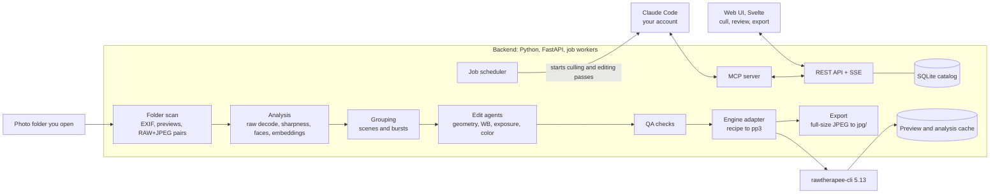
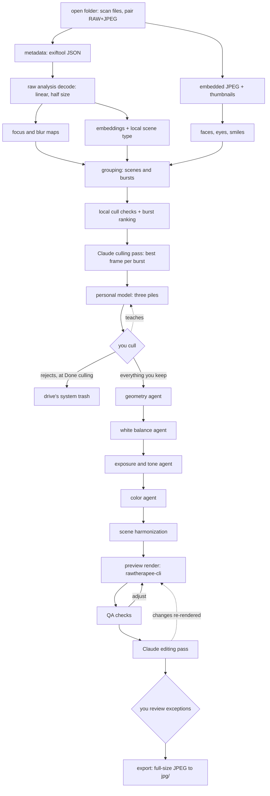

# RAW Image Editor — Implementation Plan

**Draft v0.4 · 2026-11-17 · updated after Phase 0 and the third review (§12)**

Camera: Nikon D7100 (NEF), mostly with an AF-S DX Nikkor 35mm f/1.8G, sometimes a Tokina AT-X M100 100mm f/2.8 Pro D Macro. Photos: shoot folders in `/srv/external-drive/Photos` on the 4.5 TB NTFS "Elements" USB drive. Target machine: Omarchy (Arch Linux) · Ryzen 7 3700X (8C/16T) · 32 GB RAM · GeForce GTX 1650 (4 GB). Already installed: RawTherapee 5.13, exiftool 13.55, LibRaw 0.22, libvips 8.18, lensfun 0.3.4, Claude Code 2.1.

> **How to review:** §0 is the summary. §12 lists every decision so far. The rest is detail that follows from those.

**Changelog**
- **v0.4 (2026-11-17):**
  - Culling is the main job to automate. The app pre-sorts each folder into auto-reject, auto-keep and your call, and each kind of decision goes automatic once it has proven it agrees with you.
  - Learning your taste is built in from Phase 1: every decision is logged, a personal model retrains after each folder, and Claude reads taste notes that you can edit.
  - Culling is Geeqie-fast because it uses only the camera's embedded JPEGs. Edited previews are pre-rendered in the background with a fast profile.
  - Your existing RawTherapee edits are kept as your locked edits.
  - The Phase 0 findings are folded in (§10).
- **v0.3 (2026-11-17):**
  - You open a folder; the app never imports or reorganizes photos.
  - Everything you keep after culling is edited automatically.
  - One full-size JPEG export per photo, into `jpg/` inside the folder.
  - Claude runs through Claude Code on your account. It suggests the best frame in each burst and refines the edits; there are no scene tags and no spending cap for now.
  - RawTherapee sidecars next to the photos.
  - No backup for now.
- **v0.2 (2026-11-16):** tuned for family and kids photos on fast primes; a natural, accurate look; the NTFS drive; rejects go to the trash at "Done culling"; personal-use licensing.

---

## 0. TL;DR

- **The workflow:** open a folder → the app pre-sorts it into obvious rejects, clear keepers and close calls → **you decide the close calls** and skim the rest → everything you keep is edited automatically → **you skim only the exceptions** → full-size JPEGs in `jpg/`.
- **You choose the moment; the machine does the technical work.** The UI is a keyboard-driven culling and review tool, not a slider-heavy editor.
- **Tuned for how you shoot:** family and kids, on a 35 mm f/1.8 and a 100 mm f/2.8 macro, neither of which has VR. The first automated check asks "are the eyes sharp, and is there motion blur?". Edits aim for a natural, accurate look.
- **Learns your taste:** every keep and reject you make is recorded. A personal model and Claude's taste notes get better after each folder, and more of the culling becomes automatic as the app proves it agrees with you.
- **Don't build a RAW engine.** RawTherapee 5.13 (already installed) does all rendering. The app drives it with generated `.pp3` profiles, which are plain text, documented, and stackable (`rawtherapee-cli -p base.pp3 -p image.pp3`). The app owns the *decisions* (analysis and agents) and RawTherapee owns the *pixels*. You can open any photo in the RawTherapee GUI, with the app's edits applied, to finish it by hand.
- **Edits are parametric recipes, never baked pixels.** Every parameter records who set it (an agent, Claude or you), how confident it was, and why. Anything you change is locked, and nothing automatic overwrites it.
- **Confidence routing:** if an agent is sure, the change is applied silently. If it's unsure, the change is applied conservatively and the photo goes into a short review queue. If it has no idea, the photo stays as shot and is flagged.
- **Local checks measure; Claude judges.** Computer vision and small local models measure focus, white balance, exposure and the horizon. Claude runs through Claude Code on your existing account, with no API key. It helps in two automatic passes: it suggests the best frame in each burst, and after culling it refines the edits of everything you keep. Through an **MCP server**, you can also ask for edits in plain language from Claude Code.
- **Stack:** Python + uv (same conventions as your other side projects), FastAPI, SQLite, and a Svelte UI on localhost.
- **Roadmap:** Phase 0 (scaffolding and spikes) is done and waiting for your review. Phase 1 makes culling fast and partly automatic, and starts learning from your decisions. Phase 2 edits everything you keep. Phase 3 adds Claude's culling and editing passes. Phase 4 keeps improving the personal model.

---

## 1. Goals, non-goals, principles

### Goals
1. **Automate the technical edits:** white balance, exposure and tone, color, straightening and crop, lens corrections, noise reduction, and focus/blur detection.
2. **Automate most of the culling:** the app decides the obvious keeps and rejects itself, and you only decide the close calls: the best moment, the right smile, which frame of a burst. How much it decides on its own grows as it learns your taste.
3. **Keep RAW quality and non-destructive editing:** originals are never modified, and every edit is reproducible and reversible.
4. **Learn your taste** for both culling and editing, from every decision and override you make, plus any feedback you give.
5. **Be scriptable and agent-drivable:** CLI, local API, MCP.

### Non-goals for v1
- A full manual editor (curves, masks, hundreds of sliders). The RawTherapee GUI is the escape hatch.
- Retouching, compositing (face or head swaps), generative fill.
- Local adjustments and masks (a v2 candidate).
- Importing, renaming or organizing photos. You copy photos from the card and choose the folder; the app works inside it.
- Asset management beyond that folder (keywords, people albums, face *recognition*), cloud sync, mobile, multiple users.
- Multiple export sizes or crops. Each kept photo gets one full-size JPEG.
- Other cameras. The design stays camera-agnostic, but tuning and tests target the D7100.

### Principles
1. **You decide the close calls; the machine handles the obvious ones.** A kind of decision only becomes automatic after it has proven it agrees with you, and you can always see and undo what the app decided.
2. **Never destroy silently.** The app never writes to originals. Rejects go to the system trash only when you press Done culling, so you can still restore them from your file manager. The app never empties the trash or deletes anything permanently.
3. **Parametric and reproducible.** The same recipe, engine version and agent versions always produce the same output.
4. **Abstain when unsure.** Every agent reports a confidence. Low confidence means do little and flag the photo.
5. **Consistency beats per-frame perfection.** White balance and exposure are harmonized across a scene so a sequence looks coherent.
6. **Respect intent.** In-camera exposure compensation, deliberate tilts, silhouettes and warm ambience are detected, not "fixed".
7. **Local-first.** Everything runs locally except Claude's passes, which go through Claude Code on your account. They run by default (your choice), can be switched off per folder, see only downscaled previews and burst sheets, and are cached.
8. **Use math where math works, and LLMs where judgment is needed.**

---

## 2. The workflow

1. **Open a folder.** Copy the photos from the card as you do today, for example into `/srv/external-drive/Photos/20261116 - (raw) - <shoot name>/`, then open that folder in the app (`rie open <folder>` or from the UI). The app never moves, renames or reorganizes anything in it.
2. **Browse right away.** The camera's embedded JPEGs fill a grid within seconds, grouped into scenes and bursts. Flipping between photos is instant, like Geeqie.
3. **The app pre-sorts the folder (minutes, in the background):**
   - local checks for focus and blur, closed eyes, smiles, exposure clipping and duplicates;
   - then Claude's culling pass, which suggests the best frame in each burst or group of look-alike shots, with a reason;
   - then your personal model sorts every photo into **auto-reject**, **auto-keep** or **your call**, each with a reason.
4. **Cull** with the keyboard:
   - Decide the **your call** pile. In a burst, pick the moment, and the other frames become rejects unless you keep them too.
   - Skim the **auto-reject** pile in one grid and rescue anything it got wrong.
   - Press **Done culling**. Rejects move to the system trash, and every decision you made or accepted teaches the model.
5. **Everything you kept is edited automatically:** straighten → white balance → exposure and tone → color → harmonize across the scene → render → QA → Claude's editing pass.
6. **Review only the exceptions.** See before/after and the reason for each change. Nudge (±EV, warmer/cooler, rotate), reset, lock, or apply to the whole scene.
7. **Export:** one full-size JPEG per kept photo, written to `jpg/` inside the folder. Your overrides train the style model.

---

## 3. Architecture

### 3.1 Components



- A single backend process runs the API, the job scheduler, the MCP server and the worker pools. Everything runs locally; the only network traffic is Claude Code's, while its passes run.
- Everything you look at comes either from the camera's embedded JPEG (culling) or from RawTherapee (edits and export), so previews and exports always match. The analysis decodes are only used for measuring.

### 3.2 Proposed decisions

| # | Decision | Proposal | Alternatives considered | Why |
|---|---|---|---|---|
| D1 | Render engine | **Confirmed, and validated in Phase 0 (ADR 0001).** RawTherapee 5.13 via `rawtherapee-cli` and generated `.pp3` profiles | Own NumPy/PyTorch pipeline on rawpy; darktable-cli + XMP; ART | RawTherapee already has mature demosaicing (AMaZE, RCD), noise reduction, capture sharpening, lensfun and a bundled `NIKON D7100.dcp`. Its text profiles are easy for agents to write and diff. darktable stores module parameters as binary blobs per module version, which are hard to generate. Writing our own pipeline would mean months of image science before the first good JPEG. |
| D2 | Edit format | Engine-neutral recipe JSON in the catalog, compiled to `.pp3`. The catalog is the source of truth. | Write `.pp3` directly | Allows provenance, confidence, locks and history per parameter, and keeps a second engine possible later |
| D3 | UI | **Confirmed.** Local web app in a normal browser tab: Svelte 5 + Vite + TypeScript, served by the backend | htmx + Jinja (no JS build step); a native Qt Quick app | Keyboard-heavy culling, prefetching and compare views are simpler client-side. Works in any browser and can run in an app window. |
| D4 | Analysis input | rawpy (LibRaw) linear decodes + embedded JPEGs | RawTherapee renders | Fast, linear sensor data for measuring; the embedded JPEG gives instant culling |
| D5 | ML runtime | ONNX Runtime (CUDA on the GTX 1650, CPU fallback). PyTorch only where a model needs it (GeoCalib) or for training. | PyTorch everywhere | Fewer heavy dependencies. Every model must also run on CPU. |
| D6 | Claude | **Changed in v0.3.** Claude through Claude Code on your existing account. The job scheduler starts headless `claude -p` runs that use the app's MCP tools. No API key, and no spending cap for now. | Anthropic API with a key; a local vision-language model | No extra billing or keys, and Claude Code already handles the agent loop, image viewing and tool calls. A useful local VLM won't fit in 4 GB of VRAM. |
| D7 | Storage | SQLite (WAL) catalog and file cache on the internal disk; originals on the external drive, never written to | Postgres | Single user, local, no operations work |
| D8 | Unit of work | **Decided in v0.3.** A folder you open. The app never imports, moves or renames photos. | Card import into a managed library | Matches how you already organize shoots |

### 3.3 Data model

**Catalog (SQLite)**
- `folders`: path relative to the drive, the drive's filesystem UUID, when it was opened, and its progress.
- `images`: path, content hash, paired camera JPEG if any, capture time (with sub-seconds), shutter count, dimensions and crop mode, orientation, and normalized EXIF/MakerNote fields (lens, focal length, aperture, shutter, ISO, exposure compensation, flash, Active D-Lighting, VR, AF area mode and points, focus distance, as-shot WB, Picture Control), plus the raw exiftool JSON.
- `groups`, `group_members`: scenes and bursts (bursts nested in scenes), with rank.
- `analyses`: per image, kind, version, input hash, results (sharpness stats, histograms, local scene type, embedding references).
- `faces`: box, landmarks, eyes open (L/R), smile, head pose, sharpness, track id within the burst. No identities.
- `proposals`: source (an agent or Claude) and its version, parameters, confidence, rationale, evidence (debug images), status. Claude's burst suggestions are stored here too.
- `recipes` + `recipe_history`: current parameters, locks, engine and engine version.
- `decisions`: keep/reject, rating, color label, which pile the app put the photo in and why, who made the final call (you, or you accepting the app's sort), an optional reason you gave, and when. This is the training data for culling.
- `overrides`: parameter, agent value, your value, context. This is the training data for the style model.
- `jobs`, `exports`, and `models`: each version of your personal culling model with its measured agreement, so a worse one can be rolled back.

**Taste notes:** a short Markdown file in the app's data folder (`~/.local/share/rie/taste.md`) that describes your preferences in plain words. It's drafted from your decisions and feedback, you can edit it, and Claude reads it in both passes.

**Recipe** (one per image, versioned):

```json
{
  "schema": "rie.recipe/1",
  "image": "blake3:9f2c…",
  "engine": { "name": "rawtherapee", "version": "5.13", "base_profile": "d7100-base@3" },
  "params": {
    "geometry":      { "rotate_deg": -1.35, "crop": { "x": 112, "y": 80, "w": 5776, "h": 3851, "aspect": "3:2" } },
    "white_balance": { "temperature_k": 5450, "tint": 1.03 },
    "exposure":      { "ev": 0.45, "highlight_compression": 35, "shadows": 20 },
    "color":         { "vibrance": 12, "saturation": 0 },
    "detail":        { "nr_luma": 0, "nr_chroma": "auto", "capture_sharpening": true },
    "lens":          { "profile": "lensfun-auto", "distortion": true, "vignetting": true, "ca": true }
  },
  "provenance": {
    "white_balance.temperature_k": { "source": "agent:wb@0.3.0", "confidence": 0.82, "why": "gray-edge and skin prior agree; scene median applied" },
    "geometry.rotate_deg":         { "source": "human", "locked": true }
  }
}
```

**Compiled RawTherapee partial profile**, stacked on a per-camera base profile (key names to be verified against 5.13 in Phase 0):

```ini
[White Balance]
Setting=Custom
Temperature=5450
Green=1.03

[Exposure]
Compensation=0.45
HighlightCompr=35

[Rotation]
Degree=-1.35
```

```bash
rawtherapee-cli -q -Y -o out/ -p profiles/d7100-base.pp3 -p cache/IMG_1234.agent.pp3 -j92 -js3 -c IMG_1234.NEF
```

**On disk**

```text
/srv/external-drive/Photos/20261116 - (raw) - <name>/        your folder: NEFs (never written to) + IMG_xxxx.NEF.pp3 sidecars
/srv/external-drive/Photos/20261116 - (raw) - <name>/jpg/    full-size JPEG exports
/srv/external-drive/.Trash-1000/                             rejects after "Done culling" (the drive's own system trash)
~/.local/share/rie/catalog.db                                catalog (backed up on every run)
~/.local/share/rie/taste.md                                  taste notes that you can edit; Claude reads them
~/.cache/rie/<image-hash>/                                   thumbnails, 2048 px previews, face crops, burst sheets, analysis, renders
```

**Folders and the external drive.**
- The folder you open is the unit of work. Open it again later and your decisions and edits are still there. If you rename or move it, the app re-links the photos by content hash.
- The catalog stores paths relative to the drive and identifies the drive by its filesystem UUID, so a changed mount point doesn't break anything.
- If the drive isn't connected, the app says so instead of showing an empty folder. You can still browse and cull from the cached 2048 px previews. Anything that needs the RAW files (100% zoom, renders, exports) waits until the drive is back.
- NTFS doesn't reliably keep Unix read-only permissions, so the app itself guarantees it never opens an original for writing.

**RawTherapee GUI round-trip.** The managed `IMG_xxxx.NEF.pp3` next to each original holds the complete profile, so opening the folder in RawTherapee shows exactly what the app renders. If you edit a photo there, the app notices the changed sidecar and imports the changed values as your locked parameters. Keys the app doesn't model are kept as they are. Ratings are mirrored into the profile (`[General] Rank`), so RawTherapee's file browser shows them too.

**Your existing RawTherapee edits are kept.**
- Many photos already have a sidecar with your ratings and edits; Phase 0 found 4,205 on the drive.
- The app reads them. Ratings become your ratings, and every value that differs from RawTherapee's defaults (exposure, white balance, crop and so on) becomes one of your locked parameters. The agents only fill in what you left at the default.
- Before the app first adds anything to an existing sidecar, it saves a copy in its data folder. It never removes or changes your keys.
- These sidecars also serve as reference edits for testing the agents (§9).

### 3.4 Pipeline and jobs



- **Caching:** each step's output is cached under a key of (input hash, step, step version, relevant parameters). Upgrading one agent only recomputes what depends on it.
- **Scheduler:** a persistent `jobs` table plus worker pools sized for this machine: a CPU process pool for analysis (about 6 workers), one GPU worker for model inference (so models don't compete for the 4 GB of VRAM), 2–3 concurrent `rawtherapee-cli` processes, and one Claude Code run at a time. Progress is pushed to the UI over Server-Sent Events. Jobs are idempotent, resume after a crash, and pause while the external drive is disconnected.
- **Editing starts when you press Done culling** and covers everything you kept. Rejected frames are never rendered. While you cull, the app can already start on frames that are clearly keepers.

---

## 4. Automated agents

Every agent is a deterministic, versioned function:

```python
def propose(ctx: ImageContext) -> Proposal: ...
# Proposal = params + confidence (0..1) + rationale (one sentence) + evidence (debug images)
```

The orchestrator merges proposals into the recipe, skipping any parameter you locked, then routes the photo by confidence:

| Confidence | What happens |
|---|---|
| ≥ 0.8 (tunable per agent) | applied silently |
| 0.5 – 0.8 | applied conservatively (for example, half the correction) and queued for review |
| < 0.5 | left as shot, queued for review with the reason |

### 4.1 Opening a folder and reading metadata
- You copy photos from the card yourself and open the folder. Nothing in it is moved, renamed or deleted, except that rejects go to the trash when you press Done culling.
- RAW+JPEG pairs (same file name, like your "(raw jpg)" shoots) count as one photo. The camera JPEG follows its NEF to the trash if you reject it.
- There's no backup for now (your choice), so the app's only destructive action is moving rejects to the trash, where you can restore them (§11).
- Metadata comes from one `exiftool -json -n -G1` call per folder, which is fast. These D7100 fields are used downstream, and all of them are in exiftool 13.55's Nikon tables: `SubSecTimeOriginal`, `ShutterCount`, `LensID`, `FocalLength`, `FNumber`, `ExposureTime`, `ISO`, `ExposureCompensation`, `Flash`, `ActiveD-Lighting`, `VibrationReduction`, `AFAreaMode`, `PrimaryAFPoint` / `AFPointsUsed` / `AFPointsInFocus`, `FocusDistance`, `WhiteBalance`, `PictureControlName`, `Orientation`, and the image area (DX 6000×4000 or 1.3× crop 4800×3200).
- **Embedded JPEGs (confirmed in Phase 0):** every NEF carries a full-size 6000×4000 JPEG (`JpgFromRaw`) plus a 1620×1080 one. When a folder opens, the app extracts them and caches screen-sized copies on the internal disk with libvips. That's what makes culling instant: no demosaicing at all.
- **What the D7100 records (Phase 0):**
  - `PrimaryAFPoint` and `AFPointsUsed`, but never `AFPointsInFocus`;
  - `SubSecTimeOriginal`, but only to 1/10 s, which is still enough to order burst frames;
  - `FocusDistance`, which is coarse on the 35 mm and meaningless on the Tokina.

### 4.2 Grouping: scenes and bursts
- **Burst:** consecutive frames no more than ~0.7 s apart (the D7100 shoots 6 fps, or 7 fps in 1.3× crop), with the same focal length and settings and a similar look.
- **Scene:** frames within a few minutes of each other that look alike (DINOv2 or SigLIP embeddings) under similar light. Similar light means similar as-shot WB and scene brightness, EV₁₀₀ = log₂(N²/t) − log₂(ISO/100). Flash vs. no flash splits a scene.
- **Near-duplicates** across the whole shoot are found with perceptual hashes plus embeddings.
- Scenes and bursts drive both the UI and the harmonization step.
- **Metric:** adjusted Rand index ≥ 0.9 against hand-made groupings on the golden set.

### 4.3 Focus and blur inspector
The question is "is the **subject** sharp?", not "is the image sharp?". A portrait with a blurred background is mostly soft by design.
- **Signal:** the raw green Bayer samples at half resolution. They are linear, with no demosaicing artifacts and no in-camera sharpening.
- **Sharpness map:** for each tile, gradient energy normalized by local contrast, minus an ISO-dependent noise floor estimated in flat tiles, so high-ISO grain doesn't read as detail.
- **Where to look:**
  - eyes and faces from the face model;
  - the AF points the camera used (`PrimaryAFPoint` and `AFPointsUsed`, with the 51-point layout mapped to pixels);
  - a subject/saliency detector for shots without people.
- **Verdicts:**
  - `sharp`
  - `soft`
  - `missed`: the background is clearly sharper than the subject (front- or back-focus).
  - `motion`: directional blur on the subject. This is cross-checked against shutter speed vs. 1/(1.5 × focal length) and whether VR was on.
  - `shake`: directional blur across the whole frame.
- **Relative to the burst:** each frame's subject sharpness is reported as a fraction of the burst's best. This is usually more useful than absolute thresholds.
- **Why this check comes first for you:**
  - At f/1.8 on the 35 mm, depth of field at 1 m is only about 6 cm. Focus landing on the eyelashes or ears instead of the eyes is a real, common miss.
  - Neither lens has VR. The shake threshold is about 1/50 s on the 35 mm and 1/150 s on the 100 mm, and twice as fast for pixel-level sharpness on 24 MP. Kids moving indoors in low light are the main source of motion blur.
  - Close-up macro shots with the Tokina have a tiny in-focus zone by design. They're judged on whether the most salient detail is sharp, not on how much of the frame is.
- **Calibration:** thresholds per focal length, aperture and ISO bucket are fitted on the golden set. Depth of field, from focus distance, focal length and aperture (DX circle of confusion ≈ 0.02 mm), tells whether a sharp background is expected. On the Tokina, whose recorded focus distance is meaningless, the app skips this check.
- **v2:** a small CNN trained on your own sharp frames with synthetic defocus and motion kernels plus ISO-matched noise. It's self-supervised, so no manual labels are needed.
- **UI:** a focus heatmap overlay, and a jump to 100% on the eyes or AF point.
- **Metric:** recall ≥ 95% on `missed`/`motion` at precision ≥ 80%. Missing a soft photo is worse than a false alarm, because nothing is deleted automatically.

### 4.4 Culling: pre-sorting, automation and your decisions

Culling and deleting take you the most time today, so this is the part the app automates most, in steps you control.

- **Per face:**
  - YuNet (OpenCV Zoo) finds faces at 1600 px. In Phase 0 it found all 9 faces in an outdoor group shot in 59 ms.
  - Tiling finds a few more small faces, but also false ones, so a face found on a tile counts only when the landmarker confirms it.
  - YuNet missed some close-ups where the face fills the frame, so those fall back to MediaPipe's own detector.
  - MediaPipe Face Landmarker, run on each face crop, gives eyes open (`eyeBlinkLeft/Right`), smile (`mouthSmileLeft/Right`) and head pose (is the person looking at the camera?).
  - Blinks are judged relative to the rest of the burst, because laughing or looking down scores like half-closed eyes.
  - Face sharpness comes from §4.3, along with whether the face is cut off by the frame edge.
- **Tracking, not recognition:** faces are matched across a burst by position and overlap. Nothing about who people are is computed or stored.
- **Local frame score:**
  - a soft minimum over people of (eyes open × face sharpness × facing the camera);
  - a smile bonus, configurable per scene, because not every photo needs a smile;
  - penalties for blur, motion and exposure;
  - an optional aesthetic-quality prior.

  Shots without people (pets, landscapes) are scored on subject sharpness and image quality instead.
- **Claude's culling pass:** for each burst or group of look-alike shots, the app builds one numbered side-by-side sheet: the frames plus their face crops.
  - Claude reads your taste notes (§4.11), then suggests the best frame with a one-line reason, e.g. "#4: everyone's eyes are open and the baby is looking at the camera; #2 has motion blur on the hand". It can also flag frames it would reject.
  - Single shots only get the local checks.
  - One sheet per group instead of one image per frame keeps usage low.

**Three piles.** Your personal model (§4.11) combines the local scores and Claude's suggestion into a probability that you'd reject each photo. It then sorts the folder:

| Pile | What goes in | What you do |
|---|---|---|
| **Auto-reject** | Photos it's very sure you'd reject: a missed focus, a blank frame, a duplicate clearly worse than its sibling, closed eyes when a sibling has them open | Skim one grid and rescue mistakes |
| **Auto-keep** | Clearly good photos that aren't duplicates | Nothing, unless you want to look |
| **Your call** | Everything it isn't sure about, especially close calls on expression and moment | Decide these; this is where your time goes |

Each photo carries a one-line reason for its pile. When no frame of a burst is perfect, the reason says so, e.g. "best: #4, 1 of 6 people blinking".

- **The trust dial:** each kind of decision has its own switch, set either to "suggest" (the photo lands in your call, with a suggestion) or "automatic" (it goes straight to its pile). The kinds are technical failures, duplicates, closed eyes, expression and moment, and composition.
  - At first, only technical failures and clearly worse duplicates are automatic. Expression and moment stay on "suggest", as you asked.
  - The app proposes switching a kind to automatic once it agreed with your final decision at least 95% of the time over your last few folders. You make the switch.
- **Picking in a burst:** choosing a frame marks the rest of the burst as rejects; hold Shift to keep more than one.
- **Done culling:** when you press it, the folder's rejects (with their sidecars and paired camera JPEGs) move to the system trash on the external drive, where your file manager can restore them. Everything you kept goes on to editing. Until then a reject is just a flag you can undo, and rejected frames stay visible in burst compare.
- **Metrics, shown per folder:** the share of photos decided automatically, how often you changed the app's sort, and the minutes you spent culling.
- **Initial targets:** after about five folders, half the photos are decided automatically with ≥ 95% agreement, and Claude's suggestion is your pick in ≥ 60% of bursts.

### 4.5 Geometry: straighten and crop
- **Estimates:**
  1. Line segments (LSD / FastLineDetector, after lens-distortion correction) feed a length-weighted histogram of angles around 0° and 90°.
  2. The horizon line, for landscapes and seascapes.
  3. GeoCalib (ECCV 2024, Apache-2.0) predicts camera roll and pitch with an uncertainty, even without strong lines.
- **Fusion:** estimates that agree within ~0.3° give high confidence. The scene type gates the result: strong for architecture and landscapes, weak for portraits and close-ups. With no reference lines, the agent abstains.
- **Policy:**
  - |roll| < 0.2°: leave it.
  - 0.2–8°: correct it.
  - \> 8°: probably deliberate, so flag it instead of fixing it. Claude's editing pass can confirm or undo that.
- **Auto-crop:** the largest rectangle with the original 3:2 aspect that fits inside the rotated frame (closed form). If a face or the main subject would be cut off, reduce the rotation or flag the photo.
- **v2:** keystone correction for architecture, applied partially (~70%) so it looks natural.
- **Metric:** median error ≤ 0.3° against your manual straightening where references exist, and ≤ 2% of deliberate tilts "corrected".

### 4.6 White balance
- **Domain:** linear camera RGB from the raw, with clipped and near-black pixels masked out.
- **Candidates** (cheap, so all are computed): as-shot WB, gray-world, shades-of-gray, gray-edge, and bright/white-patch. v2 adds a learned estimator (FFCC/FC4-style) trained on public datasets plus your gray-card shots.
- **Priors:**
  - The illuminant must lie near the Planckian/daylight locus, mapped into D7100 camera space through the camera's color matrices.
  - Skin tones from detected faces must fall in a plausible skin range, without forcing one particular skin tone.
  - If the flash fired, a flash prior applies.
  - Signs of mixed light lower the confidence.
- **Fusion:** a confidence-weighted median of the candidates. How much they disagree sets the confidence.
- **Intent:** you chose a natural, accurate look, so the default is to neutralize. Only clearly warm-lit scenes (sunsets, golden hour, birthday candles) keep some ambience: the correction moves only partway to neutral, using CAT16 adaptation. A setting turns this off. Warm-lit scenes are detected locally (color statistics and a small image classifier), and Claude's editing pass can overrule that call.
- **Harmonize:** frames of one scene under the same light get the scene's weighted median, so a sequence doesn't flicker. A frame deviates only with strong evidence.
- **To RawTherapee:** the multipliers are converted to RawTherapee's temperature/green values. RawTherapee's model differs from DNG-style math, so the conversion is handled in two ways:
  - a lookup table, calibrated by rendering neutral targets;
  - a check on the actual render: if the pixels that should be neutral aren't, adjust and re-render once.
- **Calibration kit** (recommended, about 30 minutes): photograph a gray card or ColorChecker in daylight, shade and flash, and under the actual lamps in your home, since indoor family shots are the hardest case. This gives ground truth for this exact camera, and optionally a custom D7100 camera profile (DCP) built with dcamprof.
- **Metric:** median angular error ≤ 2.5° on the gray-card shots. Within a harmonized scene, the temperature spread stays ≤ 100 K unless the light changed.

### 4.7 Exposure and tone
- **Measure** in scene-linear luminance:
  - log-average key and percentiles;
  - true sensor clipping per channel (raw values vs. the white level);
  - subject luminance (faces, AF point, salient region).
- **Policy:**
  - Base exposure targets a scene-dependent key: brighter for snow and beach, darker for night and stage.
  - Faces land in a plausible range **relative to that person's own skin tone**, never normalized to one brightness.
  - Clipped highlights that aren't specular are limited (e.g. ≤ 0.3% of pixels after the tone curve). When only specular highlights clip, it uses highlight reconstruction or compression instead of darkening everything.
  - Backlit subjects are lifted with shadow/local tone tools, not global exposure alone.
  - Intent: in-camera exposure compensation, silhouettes and low-key scenes are adjusted less.
  - D7100-specific: Active D-Lighting deliberately underexposes the raw, so compensate when it was on.
- **Tone:** a neutral filmic-style curve with gentle contrast, to match the natural look you chose, then contrast, shadows and highlights as needed. RawTherapee's auto-matched tone curve (the camera-JPEG look) stays available as an alternative preset.
- **Harmonize** across a scene, like white balance, while keeping real exposure differences between frames.
- **v2:** a learned predictor of parameter deltas, trained on your accepted edits (style memory, §4.11).
- **Metric:** median |ΔEV| ≤ 0.25 against your manual exposure, and < 2% of renders with clipped faces.

### 4.8 Color
- **Profiles:**
  - Input: RawTherapee's bundled `NIKON D7100.dcp`, or a custom DCP from the calibration kit.
  - Working space: Rec. 2020 (RawTherapee 5.13's new default).
  - Output: sRGB for the full-size JPEG export, since messaging apps, social media and most print labs expect it.
- **Auto vibrance** is kept modest for the natural look. It's set from chroma statistics, with skin-tone protection, gamut compression and per-scene caps (no neon foliage).
- **Looks:** neutral is the default. Camera-like and warm looks are optional presets for later.
- **Metric:** mean ΔE2000 ≤ 3 on ColorChecker patches.

### 4.9 Technical baseline (rules, not AI)
- Lens corrections from lensfun (distortion, vignetting, lateral CA), looked up by `LensID`. Both of your lenses are in lensfun 0.3.4's database. The AF-S DX Nikkor 35mm f/1.8G has distortion, TCA and vignetting data. Phase 0 found that the entry matching the Tokina AT-X M100 100mm f/2.8 Pro D Macro has no vignetting data; a few flat-field shots could fill that in later.
- Demosaicing with AMaZE or RCD. The D7100 has no optical low-pass filter, so it is prone to moiré; compare both on real shots in Phase 0.
- Capture sharpening with auto radius, plus output sharpening per export size.
- Noise reduction based on the **effective ISO** = ISO × 2^(exposure push), using a table tuned on the golden set.
- Hot-pixel filtering for long exposures.

### 4.10 QA (deterministic, on the actual render)
- Checks:
  - clipped faces or subject, and crushed shadows;
  - the horizon is still level after the crop;
  - neutrals are neutral;
  - no faces are cropped;
  - no saturation is out of gamut;
  - optionally, a before/after image-quality score ("did the edit make it worse?").
- If a check fails, the agent re-adjusts once; if it still fails, the photo is queued for review.

### 4.11 Learning your taste

Most of your feedback comes from simply culling and reviewing as usual: the app learns from what you do.

**What it learns from**
- **Every decision, automatically:**
  - keep or reject;
  - which frame you picked in a burst;
  - each time you moved a photo out of the pile the app chose;
  - every edit you changed, recorded as the image features, the app's or Claude's value, and your value.
- **Optional quick reasons:** when you overrule the app, a small picker offers blur, eyes, expression, duplicate or composition. Press one key, or ignore it.
- **Notes in your own words:** type them in a "tell the app" box, or just tell Claude in Claude Code, e.g. "I prefer candid laughs over posed smiles". They go into your taste notes.
- **Your history, if you agree (still open, §12):**
  - your existing RawTherapee ratings and edits;
  - the photos still in your folders, as keepers;
  - the NEFs in the drive's trash, as rejects;
  - old bursts where only one frame survived, as your picks.

  This is all read-only and local, and none of it goes to Claude.

**How it uses that**
- **Personal culling model:** a small gradient-boosted model predicts whether you'd reject a photo. It uses the local features: sharpness at the eyes, eyes open, smile, gaze, motion blur, clipping, rank within the burst, Claude's suggestion and scene type. A pairwise ranker learns which frame you pick in a burst. Both retrain after each folder, in seconds, on this machine.
- **Taste notes for Claude:** after each folder, Claude drafts updates to `taste.md` from the cases where you disagreed with it, e.g. "keeps laughing shots even with half-closed eyes" or "rejects frames where the baby looks away". You approve or edit each change, and both of Claude's passes read the notes.
- **Editing taste:** it builds up in three steps:
  1. per-scene biases, such as "+0.2 EV on indoor portraits";
  2. nearest neighbors over your accepted edits: "edit it like the similar photos I already finished";
  3. gradient-boosted models for parameter changes.

**Guardrails**
- A new model version replaces the old one only if replaying your recent folders shows that it agrees with you at least as well. Every version is kept, so a worse one can be rolled back.
- The trust dial (§4.4) only goes automatic with your OK.

---

## 5. Claude: culling suggestions and editing help

Claude runs through **Claude Code on your existing account**, with no API key and no separate billing. Its use counts against your Claude plan's usage limits, and there's no extra spending cap for now. The local checks still do the measuring (sharpness, eyes, clipping); Claude adds judgment. There are no AI scene tags.

| Pass | What Claude does | When | What it sees |
|---|---|---|---|
| **Culling pass** | Suggests the best frame in each burst or group of look-alike shots, with a one-line reason, and flags frames it would reject, guided by your taste notes | Automatically, after the local checks, when you open a folder | One numbered side-by-side sheet per group: the frames plus their face crops |
| **Editing pass** | Reviews each kept photo's before/after render and adjusts the agents' parameters within bounds, with a reason. It can zoom to 100% on eyes and skin. | Automatically, after you press Done culling, for everything you kept | Before/after previews (~1024 px), histogram and clipping mask, plus crops on request |
| **Ask anything** | Handles requests like "These indoor shots look too yellow. Cool them a bit and keep the faces bright." | When you ask, in Claude Code | The same tools, interactively |

**How it works**
- The app runs an MCP server that exposes the open folder as tools.
- For the two automatic passes, the job scheduler starts Claude Code in headless mode (`claude -p`) with that MCP server and a fixed, versioned prompt. It works through one folder at a time, in chunks. Claude Code 2.1 is already installed.
- The same MCP server also works in an interactive Claude Code session, for "ask anything".
- Results land in the catalog as proposals, the same way the local agents' results do, so the review UI shows them identically.

**MCP tools (sketch):** `list_folders`, `get_group_sheet(group)`, `suggest_frames(group, ranking, reasons)`, `get_image(id)` (metadata, analysis, recipe and reasons), `get_preview(id, size, before_or_after)`, `crop_zoom(id, bbox)`, `propose_edit(ids or scene, deltas, reason)`, `render(ids)`, `get_taste_notes()`, `propose_taste_note(text, examples)`.

**Guardrails**
- Claude's culling suggestions are only suggestions; every keep/reject decision is yours.
- An edit from Claude becomes a new recipe version (one-key undo) and never overrides your locks.
- Each pass may change a parameter only within bounds (for example ±1 EV or ±1000 K), so one bad call can't wreck a photo.
- No tool can delete, move or rename files.

**Practical notes**
- **Usage:** a 400-frame folder with ~60 bursts means about 60 sheets for culling, plus one review per kept photo for editing. Runs work in chunks and resume, so hitting your plan's usage limit only pauses them. The app shows how far each pass has got.
- **Measured in Phase 0:** two bursts took 19 s on Opus 5.5, and both picks were sensible. `--bare` can't be used, because it ignores the subscription login.
- **Reproducibility:** Claude's answers aren't deterministic, so each one is cached by (image hash, recipe hash, prompt version) and kept in the proposal history.
- **Model:** whichever model your Claude Code is set to. The passes don't hard-code one.
- **Privacy:** Claude sees only downscaled previews and sheets (no RAW files, no location), and those include your family's faces. A folder can opt out, and `--no-claude` runs everything locally.
- **Fallback:** if you ever want big unattended runs that don't use your plan's limits, the same prompts can run against the Anthropic API with a key.

---

## 6. Frontend (very light)

**Views**
1. **Folders:** recently opened folders with their progress (analyzed → culled → edited → exported), and a field to open another folder by path.
2. **Cull:**
   - three tabs for the piles: **your call** (opens first), **auto-reject** (one dense grid to skim and rescue from) and **auto-keep**;
   - a grid grouped by scene, with bursts collapsed to their best frame and a count;
   - a loupe that shows the embedded JPEG;
   - badges for focus verdict, eyes and clipping, plus the pile's reason and Claude's suggested frame;
   - a focus heatmap and 100% zoom on the eyes or AF point;
   - the optional reason picker, shown when you overrule the app;
   - a **Done culling** button. It shows how many rejects there are, moves them (with paired camera JPEGs) to the system trash, and starts editing everything you kept.
3. **Burst compare:** 2–6 frames side by side, plus **face strips** with one row per person and one column per frame. Each strip is a 100% crop with eyes, smile and sharpness badges, so finding the frame where everyone looks right takes one glance. Claude's suggested frame is marked. Picking a frame rejects the others; Shift keeps more than one.
4. **Review:** everything you kept, with a "needs a look" filter and before/after. Each changed parameter gets a chip with the agent's reason and confidence, e.g. "WB 5450 K · 82% · gray-edge and skin agree". From here you can nudge, reset to as-shot, lock, apply to the burst or scene, or open the photo in RawTherapee.
5. **Export:** one button that writes full-size JPEGs of everything you kept into `jpg/` inside the folder, with metadata (artist/copyright) and progress.
6. **Taste:** your taste notes (editable), Claude's proposed changes to approve, the trust-dial switches, and how well the app agreed with you, folder by folder.

**Keyboard (draft)**

| Key | Action | Key | Action |
|---|---|---|---|
| ← → | previous / next frame | `\` | before / after |
| ↑ ↓ | previous / next burst | `[` `]` | exposure −/+ 0.15 EV |
| P X U | keep / reject / unflag | `,` `.` | cooler / warmer |
| 1–5, 0 | rating / clear | `{` `}` | rotate −/+ 0.1° |
| Z | 100% on eyes / AF point | R | reset parameter to as-shot |
| F | focus heatmap | L | lock parameter |
| C | burst compare | E | open in RawTherapee |
| A | accept Claude's burst suggestion | ? | help |

**Speed**
- **Culling is Geeqie-fast.** It never waits on RawTherapee. It shows the camera's embedded JPEGs: screen-sized copies cached when the folder opens, and the full-size one for 100% zoom. The browser prefetches and decodes the next and previous five photos.
  - Targets: ≤ 50 ms to flip to the next photo, ≤ 150 ms to zoom to 100%.
- **Edited previews are ready before you look.** After Done culling, every kept photo is rendered in the background with a fast preview profile, four renders at a time. The profile skips capture sharpening and raw CA correction, which only matter at close zoom.
  - Phase 0 measured 1.8 s per image with four renders in parallel on the full profile, and 1.7 s for a single render with the slow steps off. In parallel, the fast profile should get close to 1 s per image (to measure).
  - The export always uses the full profile.
- **Nudges preview instantly** in the browser (WebGL gain, exposure and rotation applied to the current preview), and the real render replaces them a moment later.

**API sketch:** `GET /api/shoots`, `GET /api/shoots/{id}/groups`, `GET /api/images/{id}`, `GET /api/images/{id}/preview?kind=embedded|render&size=…`, `GET /api/images/{id}/faces`, `POST /api/images/{id}/decision`, `PATCH /api/images/{id}/recipe`, `POST /api/groups/{id}/apply`, `POST /api/jobs`, `GET /api/events` (SSE).

**Running it:** `rie serve` starts the UI at `http://localhost:7317`, used in a normal browser tab. A systemd user service can keep background work running later.

### 6.1 Export

There is one export: a full-size JPEG per kept photo, written to `jpg/` inside the folder with the same base name (`IMG_1234.NEF` becomes `jpg/IMG_1234.jpg`).
- Full resolution (or the crop, if there is one), sRGB, quality 95, no chroma subsampling (`-js3`), mild output sharpening.
- After rendering, exiftool copies the metadata over from the NEF. Phase 0 found that RawTherapee's JPEGs drop the sub-second time and the lens name.
- Re-exporting after an edit overwrites that photo's JPEG.
- Resizing for messaging apps or social media is left to those apps.

---

## 7. Tech stack

| Area | Choice | Notes |
|---|---|---|
| Runtime | Python 3.13, pinned with uv (chosen in Phase 0) | System Python is 3.14; the whole stack also installs on 3.12 and 3.14 |
| RAW decode for analysis | rawpy (LibRaw) | MIT; linear output, half-size decode, Bayer access |
| Metadata | exiftool 13.55 | `-json` batch per folder, `-stay_open` for single files; a thin in-house wrapper |
| Image operations | pyvips (libvips 8.18), OpenCV, NumPy, scikit-image, Pillow | thumbnails, crops, analysis |
| Color math | colour-science | CCT/tint, CAT16, ΔE2000 |
| Taste model | LightGBM or scikit-learn gradient boosting | Small; retrains in seconds after each folder |
| Rendering | rawtherapee-cli 5.13 | Stacked partial profiles: a fast preview profile and the full export profile (`-f` does nothing in the CLI, per Phase 0) |
| ML inference | ONNX Runtime (CUDA on the GTX 1650, CPU fallback); PyTorch where needed | The GTX 1650 is fine for small models, not for local VLMs |
| Models | YuNet (MIT), MediaPipe Face Landmarker (Apache-2.0), DINOv2 (Apache-2.0) or SigLIP embeddings, GeoCalib (Apache-2.0), optional IQA metrics via pyiqa (custom license, non-commercial terms) | `models/manifest.toml` records each model's source, hash and license. The app is for personal use only, so non-commercial weights (e.g. InsightFace) are allowed if they help |
| Claude | Claude Code 2.1 (installed), headless `claude -p` runs | Your existing account; no API key; no spending cap for now |
| MCP | official MCP Python SDK | stdio server for Claude Code |
| Backend | FastAPI + Uvicorn, Server-Sent Events | |
| Storage | SQLite (WAL) + plain SQL migrations | |
| Trash | send2trash | Freedesktop trash, including the drive's own `.Trash-1000` folder, so rejects stay on the external drive |
| Jobs | in-process scheduler + `jobs` table + worker pools | no Redis or Celery |
| Frontend | Svelte 5, Vite, TypeScript | Node via mise (already installed) |
| Quality | ruff, pyright, pytest, hypothesis, Playwright smoke tests | |

---

## 8. Repository layout

Same conventions as your other side projects (uv, `src/` layout, `AGENTS.md` / `CLAUDE.md`, `PROJECT_STATUS.md`, `config.example.toml`).

```text
raw-image-editor/
├── README.md
├── IMPLEMENTATION_PLAN.md
├── AGENTS.md, CLAUDE.md          # Phase 0
├── PROJECT_STATUS.md             # Phase 0
├── pyproject.toml, uv.lock, .python-version
├── config.example.toml           # drive and folder settings, Claude on/off, thresholds
├── src/rie/
│   ├── cli.py                    # rie open | analyze | edit | serve | export | eval
│   ├── config.py
│   ├── catalog/                  # schema, migrations, repositories
│   ├── scan/                     # folder scan, RAW+JPEG pairing, hashing, exiftool, previews
│   ├── analysis/                 # raw decode, sharpness, faces, embeddings, grouping
│   ├── agents/                   # focus, culling, geometry, wb, exposure, color, qa, style
│   ├── assistant/                # Claude Code runner, prompts, burst sheets, response cache
│   ├── engine/                   # recipe schema, pp3 compiler/parser, rawtherapee runner
│   ├── jobs/                     # scheduler, workers, events
│   ├── api/                      # FastAPI routes
│   └── mcp/                      # MCP server
├── profiles/rawtherapee/         # d7100-base.pp3, preview overlay, export profile
├── web/                          # Svelte app
├── models/                       # weights (git-ignored) + manifest with hashes and licenses
├── eval/                         # golden-set manifest, labels, metric scripts, reports
├── docs/adr/                     # architecture decision records
├── scripts/
└── tests/                        # unit, integration (CC0 sample NEFs), golden regressions
```

---

## 9. Evaluation and testing

**Golden set** (Phase 0): ~200 of your NEFs, plus the calibration-kit shots. Mostly family and kids, the way you actually shoot them:
- indoor shots under your home's lighting at f/1.8 and high ISO (3200+), including near-misses on focus and motion blur;
- daylight, shade, flash and backlight;
- kids bursts and group shots;
- some 100 mm portraits and macro shots;
- a few horizons, deliberate tilts and silhouettes.

The golden set stays outside the repo (its path is in the config); the repo keeps the manifest and the labels.

**Labels**, made in the app or in tools you already use:
- focus verdicts and the best frame of each burst, via the culling UI;
- reference edits: your existing RawTherapee sidecars already hold many of your edits, so the golden set can mostly use those; edit a few more in RawTherapee where a scenario is missing.

**North-star metric — your effort:**
- the minutes it takes you to cull 100 photos;
- the share of photos the app decided on its own, and how often you changed those decisions;
- the share of kept photos whose edits you touch;
- the average size of your edit overrides.

 Per-agent metrics are listed in §4.

**Performance targets** (updated with Phase 0 measurements):

| Step | Target |
|---|---|
| Grid browsable after opening a folder | first thumbnails within seconds; 500 photos in ≤ 30 s (embedded previews) |
| Analysis (faces, sharpness, embeddings) | ≤ 0.5 s per image, so 500 images in ≤ 5 min |
| Claude's culling pass | about 10 s per burst (Phase 0: two bursts in 19 s) |
| Edited preview (fast profile, 4 in parallel) | about 1 s per image, all done in the background before you review (to measure) |
| Full-resolution export | ≤ 6 s per image (Phase 0: 3.7–4.0 s, 5.7 s with noise reduction) |
| Culling: next photo / 100% zoom | ≤ 50 ms / ≤ 150 ms (embedded JPEGs, Geeqie-style) |

**Tests**
- **Unit:** temperature/tint ↔ multipliers, crop geometry, `.pp3` compile/parse round-trip, grouping.
- **Property-based:** the crop always lies inside the rotated frame and keeps faces.
- **Integration:** CC0 D7100 samples from raw.pixls.us, run in CI.
- **Golden regression:** every agent or RawTherapee version bump re-runs the golden set and produces a metrics diff plus an image grid. The RawTherapee version is recorded in every recipe.
- **UI:** Playwright smoke tests of the cull and review flows.

**Rule:** no threshold goes into the code without a golden-set number behind it.

---

## 10. Roadmap

Estimates are in weeks of focused part-time work with AI-assisted coding. They set the order, not deadlines. Each phase ends with something you can use.

### Phase 0 — Foundations and spikes · done, waiting for your review
Pushed as branch `claude/phase-0-599a9b`:
- the scaffold, `rie render` and `rie check`;
- six ADRs in `docs/adr/`;
- 88 passing tests.

Still to do: the golden set and the calibration-kit shots, which need you. The original scope was:
- Scaffolding: uv, ruff, pytest, `AGENTS.md` / `CLAUDE.md`, `PROJECT_STATUS.md`, `config.example.toml`.
- Golden set and calibration-kit shots.
- Spikes, each ending in a short ADR under `docs/adr/`:
  1. **RawTherapee CLI:**
     - render a D7100 NEF from stacked partial profiles;
     - time renders at 2048 px and at full resolution, with the full and the `-f` fast-export pipelines;
     - compare AMaZE vs. RCD on moiré-prone shots;
     - confirm the `.pp3` keys for WB, exposure, rotation, crop, lens and DCP.
  2. **NEF metadata:** check for the embedded full-size JPEG, which AF-point tags the D7100 fills in, sub-second timestamps, and focus distance.
  3. **Faces, eyes and smiles:** run YuNet + MediaPipe on ~30 portrait and group shots on this machine.
  4. **Python version:** 3.12 vs. 3.13, based on wheel availability.
  5. **External drive:** partly confirmed already, since the drive's `.Trash-1000` holds trashed NEFs, so trashing stays on the drive. Still to work out: how the app detects that the drive is unplugged.
  6. **Claude Code headless:** run `claude -p` with the app's MCP server on a sample burst sheet and a sample edit, and measure the time and plan usage per item.
- **Exit:** `rie render IMG.NEF --recipe r.json` produces a correct JPEG, and D1–D7 are confirmed or changed.

### Phase 1 — Fast, partly automatic culling · MVP 1 "cull in a fraction of the time" (~3 weeks)
- Catalog and migrations; `rie open <folder>` (scan, RAW+JPEG pairing, re-linking by content hash); external-drive detection; exiftool batch.
- Geeqie-fast viewing: embedded JPEGs extracted and screen-size copies cached when a folder opens; the browser prefetches neighbors.
- Grouping; focus inspector v1; faces, eyes and smiles; burst ranking v1.
- Existing RawTherapee sidecars: ratings and edits imported as yours.
- Decision logging from the first folder, with the optional reason picker.
- The three piles and the trust dial: technical failures and clearly worse duplicates automatic, everything else suggested. A first personal model, bootstrapped from your history if you agree.
- UI:
  - folders, the three pile tabs, the cull grid, and the loupe with 100% zoom;
  - the focus heatmap, and burst compare with face strips (picking a frame rejects the rest);
  - the keyboard map, and "Done culling" (rejects to the system trash);
  - ratings mirrored to RawTherapee.
- **Exit:**
  - a real 300-frame shoot is culled end to end in the app, noticeably faster than in Geeqie;
  - at least 30% of the photos are decided automatically, and you change fewer than 5% of those;
  - the focus recall target is met on the golden set;
  - originals are untouched.

### Phase 2 — Auto-edit agents v1 · MVP 2 "everything you keep comes out edited" (~3–4 weeks)
- Recipe schema, `.pp3` compiler/parser, RawTherapee runner, render cache, D7100 base profile.
- Technical baseline: lens corrections, demosaicing, noise reduction by effective ISO, sharpening.
- Geometry, white balance, exposure/tone and color agents; scene harmonization; confidence routing; QA on the actual renders (closed loop).
- Review UI (before/after, reason chips, nudges, locks, apply to scene, open in RawTherapee) and the RawTherapee GUI round-trip.
- Export: full-size JPEGs into `jpg/`.
- **Exit:** ≥ 70% of kept golden-set photos need no override (re-baselined after Phase 0), and per-agent metrics are reported.

### Phase 3 — Claude passes and MCP (~2 weeks)
- MCP server: read, previews, burst sheets, crop/zoom, suggest frames, propose edits, render. Nothing destructive.
- Headless runner: starts `claude -p` per folder, in chunks that resume, with response caching and progress in the UI.
- Culling pass: burst sheets plus your taste notes → Claude's suggested frame and reason in the cull view. Claude also drafts taste-note updates from your disagreements.
- Editing pass on everything you keep, with bounded changes and `crop_zoom`, A/B-tested against no editing pass on the golden set.
- Interactive use from Claude Code ("ask anything").
- **Exit:**
  - Claude's suggestion is your pick in most bursts (target set after Phase 0);
  - the editing pass measurably reduces your overrides;
  - a plain-language request from Claude Code lands on a scene and is reviewed in the UI.

### Phase 4 — Keep learning (~2 weeks, then ongoing)
- Editing taste: style memory v1/v2 from your edit overrides and your existing RawTherapee edits.
- Culling: retrain after every folder, widen the trust dial as each kind of decision earns it, and roll back any model version that agrees with you less.
- Performance pass (GPU batching, pool sizes), resumable jobs, packaging (systemd user service).
- **Exit:** over consecutive folders, the share of photos decided automatically goes up and your override rate goes down.

### Later candidates
- Local adjustments with masks (subject and sky, e.g. SAM 2)
- Keystone correction
- Learned denoising
- Focus classifier v2
- Dust-spot detection
- Captions and keywords for search
- darktable export
- Other cameras

---

## 11. Risks and mitigations

| Risk | Mitigation |
|---|---|
| RawTherapee parameters don't map cleanly to our measurements (especially WB temperature/green) | Calibrate with rendered neutral targets; verify on the real render (closed loop); `.pp3` round-trip tests; pin and record the RawTherapee version |
| `rawtherapee-cli` is too slow for interactive nudges | Embedded JPEGs for culling; pre-render kept photos in the background; instant in-browser approximations; a fast preview profile |
| Over-correction kills the mood | Warm-scene detection, partial corrections, Claude's editing pass, respect for in-camera exposure compensation, confidence routing, one-key reset |
| Straightening + cropping cuts off heads | Face- and subject-aware crop check; reduce the correction or flag |
| Burst suggestions favor the wrong things (e.g. smiles over real moments) | They're only suggestions, with Claude's reason shown; per-scene weights; the ranking learns from your picks |
| Skin-tone bias in WB or exposure | Per-person relative targets with no single "correct" skin tone; diverse skin tones in the golden set |
| Model licenses | Personal use only, so non-commercial weights are acceptable; the manifest still records licenses in case that changes |
| Privacy (faces, cloud) | No identity recognition; Claude sees only downscaled previews and sheets; per-folder opt-out and `--no-claude` |
| Claude's passes hit your plan's usage limits on a big folder | One sheet per burst instead of one image per frame; local checks first; runs work in chunks that pause and resume |
| Data loss | Originals never written to; rejects only go to the trash and are never deleted permanently; catalog backups |
| Auto-reject throws away a photo you wanted | Only kinds of decision you switched to automatic; a one-grid skim of the auto-reject pile before Done culling; rejects only go to the trash; agreement tracked per kind |
| The personal model drifts or overfits | Replayed on your recent folders before each update; every version kept for rollback |
| Learning from your trash and old folders | Only with your OK; read-only and local; nothing from it goes to Claude |
| Existing RawTherapee sidecars get damaged | The app backs up each sidecar once before it first adds to it, and never changes your keys |
| Your photos have no backup (your choice for now) | The app never writes to originals and only moves rejects to the trash, where they can be restored; revisit backups later (§12) |
| Drive unplugged or remounted mid-job | Drive identified by filesystem UUID; jobs pause and resume; cached previews keep culling possible |
| NTFS doesn't enforce Unix read-only permissions | The app never opens originals for writing, and tests check that |
| GTX 1650 limits (4 GB; a future CUDA release may drop Turing) | Small models only; everything also runs on CPU |
| Scope creep toward "build Lightroom" | The non-goals list; the RawTherapee GUI as the manual escape hatch |

---

## 12. Decisions so far

| # | Topic | Decision | Since | Sections |
|---|---|---|---|---|
| 1 | What you shoot | Family and kids | v0.2 | §4.3, §4.4, §4.6 |
| 2 | Bursts | Sometimes | v0.2 | §4.4 |
| 3 | Look | Natural and accurate | v0.2 | §4.6–§4.8 |
| 4 | Render engine | RawTherapee (D1) | v0.2 | §3.2 |
| 5 | Existing edits | Your existing RawTherapee ratings and edits are kept as your locked edits (changed in v0.4) | v0.4 | §3.3 |
| 6 | Lenses | AF-S DX 35mm f/1.8G mostly, Tokina 100mm f/2.8 Macro sometimes; both in lensfun, neither with VR | v0.2 | §4.3, §4.9 |
| 7 | UI | Browser tab (D3) | v0.2 | §6 |
| 8 | Licensing | Personal use only | v0.2 | §7 |
| 9 | Where photos live | Your shoot folders on the external NTFS drive | v0.2 | §3.3 |
| 10 | Workflow | You open a folder; the app never imports, moves or renames photos (D8) | v0.3 | §2, §4.1 |
| 11 | Rejects | Moved to the drive's system trash when you press Done culling | v0.2 | §4.4 |
| 12 | What gets edited | Everything you keep after culling | v0.3 | §2, §3.4 |
| 13 | Export | One full-size JPEG per kept photo, in `jpg/` inside the folder (replaces the four presets) | v0.3 | §6.1 |
| 14 | Sidecars | RawTherapee `.pp3` next to each photo; an existing one is backed up once before the app first adds to it | v0.3 | §3.3 |
| 15 | Claude | Through Claude Code on your account; suggests burst frames and refines edits, both automatically; no scene tags; no spending cap for now (D6) | v0.3 | §5 |
| 16 | Backup | None for now | v0.3 | §4.1, §11 |
| 17 | Speed | As fast as possible: culling shows only embedded JPEGs (Geeqie-style); edited previews are pre-rendered in the background with a fast profile | v0.4 | §6, §9 |
| 18 | Culling automation | Three piles (auto-reject, auto-keep, your call), with a per-kind trust dial that goes automatic only with your OK | v0.4 | §4.4 |
| 19 | Learning your taste | Every decision teaches a personal model, and Claude keeps taste notes that you can edit | v0.4 | §4.11 |

**Still open**
1. **Learning from your history.** May the app bootstrap your personal model from your existing folders, your RawTherapee ratings and the NEFs in the drive's trash? It's read-only and local, and nothing goes to Claude.
2. **Backups (deferred).** When you want one, the simplest option is a second USB drive that each finished folder gets copied to.

---

## Appendix A — Nikon D7100 facts that shape the design

| Fact | Design consequence |
|---|---|
| 24.1 MP DX sensor (6000×4000); 1.3× crop mode gives 4800×3200 | Handle both image sizes |
| No optical low-pass filter: more detail, more moiré | The demosaicing choice matters |
| ISO 100–6400 native (Hi-1/Hi-2 up to 25600) | Noise reduction by effective ISO |
| 51-point AF (15 cross-type); AF area mode and points are recorded in the MakerNotes | Check focus where the camera focused |
| 6 fps (7 fps in 1.3× crop) | Burst grouping thresholds |
| 12/14-bit NEF, lossless compressed or compressed | — |
| Active D-Lighting underexposes the raw | Exposure compensation logic |
| RawTherapee 5.13 ships `NIKON D7100.dcp` | Input color profile |
| Your lenses: AF-S DX 35mm f/1.8G and Tokina AT-X M100 100mm f/2.8 Macro, neither with VR | Shake thresholds per focal length; lensfun profiles exist for both, though the Tokina's has no vignetting data |

## Appendix B — References

- RawTherapee: `rawtherapee-cli -h` (5.13: partial-profile stacking, output options); RawPedia pages "Command-Line Options" and "Sidecar Files – Processing Profiles"; [5.13 release notes](https://www.rawtherapee.com/downloads/5.13/)
- darktable's "rotate and perspective" module: an LSD-based auto-straightening reference implementation
- GeoCalib: Veicht et al., ECCV 2024, [github.com/cvg/GeoCalib](https://github.com/cvg/GeoCalib) (Apache-2.0)
- [MediaPipe Face Landmarker](https://ai.google.dev/edge/mediapipe/solutions/vision/face_landmarker): blendshapes for blinks and smiles
- Color constancy: gray-edge (van de Weijer et al., 2007), FC4 (Hu et al., 2017), FFCC (Barron & Tsai, 2017), C5 (Afifi et al., 2021)
- Hu et al., "Exposure: A White-Box Photo Post-Processing Framework" (2018): interpretable, parametric editing by an agent
- MIT-Adobe FiveK (Bychkovsky et al., 2011): RAW photos with expert retouches (research use)
- [raw.pixls.us](https://raw.pixls.us/): CC0 sample raws for tests
- Claude Code docs: [headless mode](https://code.claude.com/docs/en/headless), [MCP](https://code.claude.com/docs/en/mcp), [CLI reference](https://code.claude.com/docs/en/cli-reference)
